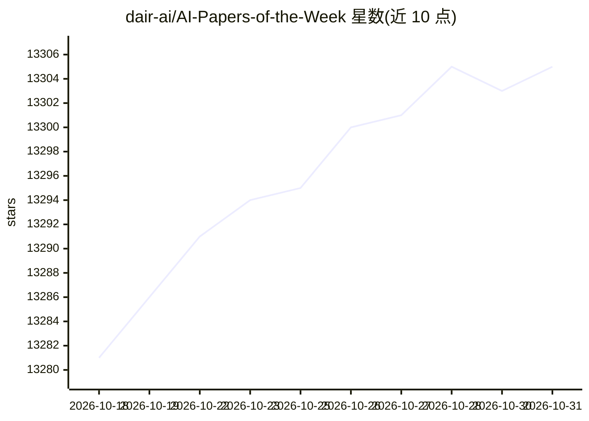

# dair-ai/AI-Papers-of-the-Week

⭐ 13,305 · 推送 2026-10-26 · [GitHub](https://github.com/dair-ai/AI-Papers-of-the-Week) · 组织维护

**DAIR.AI 维护的每周顶会 AI 论文周报清单**

由 DAIR.AI 维护的仓库，按周列出年度 Top AI Papers of the Week 系列，覆盖 2023 年 1 月至 2026 年 10 月的每周条目，每条对应一份周度论文精选。仓库同时提供邮件订阅入口与 Twitter、Discord 社区链接。内容为纯清单，不含代码、安装或运行方式，面向跟踪 AI 论文动态的读者。

## 筛选速览

| 维度 | 判定 | 备注 |
|---|---|---|
| AI 角色 | `ai-knowledge` | 知识聚合/清单类 |
| 许可风险 | `none` | — |
| 部署形态 | `None` |  |
| 模型依赖 | — | README 未给出锁定关系 |
| 硬件要求 | — | 无带数字的原话,不猜 |
| 安装摩擦 | `low` | 无编译、无系统依赖或容器化 |
| 成熟度 | — | 结构信号不足 |

## 动量与使用信号

- 维护:`active` — 距上次 push 5.7 天,年发版 0,9 位贡献者
- 涨星:近 1 天 **+2**(自 20261016 起算)
- 安装:github 包 `release-assets` 月下载无数据

## 能力要点

- 按周组织的 AI 论文精选条目，覆盖 2023-2026 年
- 提供每周论文列表的邮件订阅渠道
- 附带 Twitter 与 Discord 社区入口

## 适用场景

- 每周跟踪 AI 领域论文动态
- 回溯查找某一周的论文精选列表
- 通过邮件订阅获取每周论文推送

## 场景标签

`精选清单` · 领域:学习与行业

## 证据(README 行号)

> L5: At DAIR.AI we ❤️ reading AI papers so we've created this repo to highlight the top AI papers of every week.
> L10: - Top AI Papers of the Week (October 12 - October 18)

## 星数曲线

2026-10-18 13,281 → 2026-10-31 13,305（+24）

---
*卡片 v1 · prompt 1.4 · 生成 2026-10-20 · 置信度 high · 依据 README sha `22166d2af36e` · [字段定义](../../DATASET.md)*
