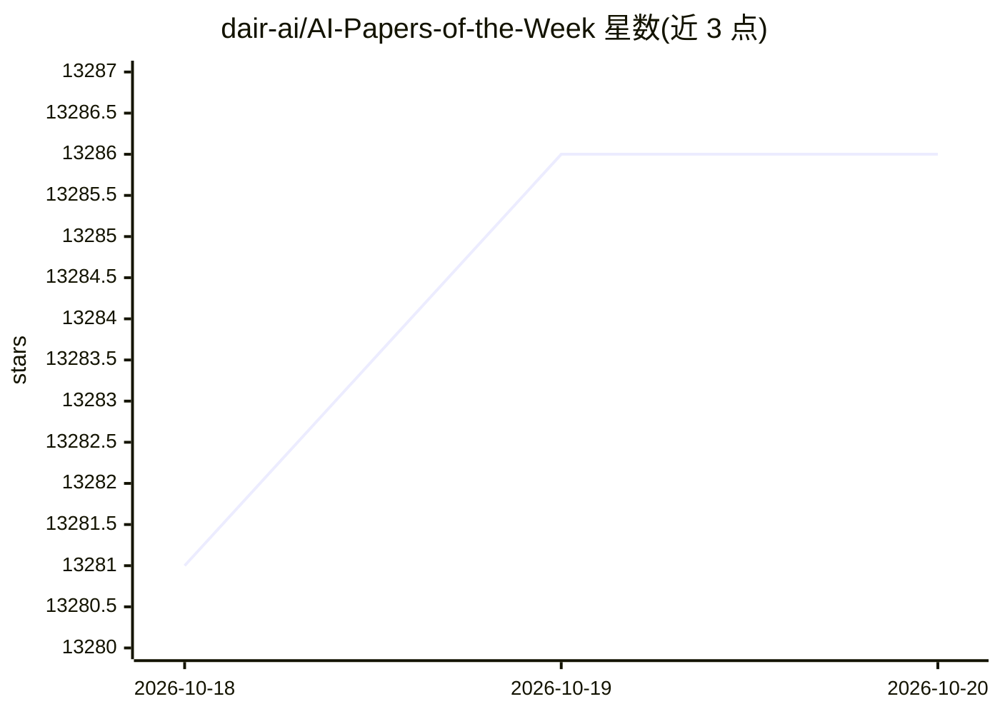

# dair-ai/AI-Papers-of-the-Week

⭐ 13,286 · 推送 2026-10-19 · [GitHub](https://github.com/dair-ai/AI-Papers-of-the-Week) · 组织维护

**面向 ML 从业者的每周 AI 论文精选清单**

DAIR.AI 维护的每周 AI 论文精选仓库：按周汇总当周值得关注的 AI/ML 论文链接，列表自 2023 年 1 月起持续更新至 2026 年，按年份分组归档；另有 newsletter 订阅渠道将每周清单发送至邮箱，并通过 Twitter 与 Discord 进行发布和社区交流。仓库本身为索引型内容，不包含安装或运行步骤。

## 筛选速览

| 维度 | 判定 | 备注 |
|---|---|---|
| AI 角色 | `ai-knowledge` | 知识聚合/清单类 |
| 许可风险 | `none` | — |
| 部署形态 | `None` |  |
| 模型依赖 | — | README 未给出锁定关系 |
| 硬件要求 | — | 无带数字的原话,不猜 |
| 安装摩擦 | `low` | 无编译、无系统依赖或容器化 |
| 成熟度 | — | 结构信号不足 |

## 动量与使用信号

- 维护:`active` — 距上次 push 5.7 天,年发版 0,9 位贡献者
- 涨星:近 1 天 **+2**(自 20261016 起算)

## 能力要点

- 按周归档的 AI 论文清单（2023 年至今，按年份分组）
- 提供 newsletter 邮件订阅渠道
- 配套 Twitter 与 Discord 发布/交流渠道

## 适用场景

- 每周追踪 AI/ML 领域新论文
- 按时间线回溯某段时间的代表性论文
- 通过邮件订阅定期获取论文列表

## 场景标签

`精选清单` · 领域:学习与行业

## 证据(README 行号)

> L3: Subscribe to our newsletter to get a weekly list of top AI papers in your inbox.
> L5: At DAIR.AI we ❤️ reading AI papers so we've created this repo to highlight the top AI papers of every week.
> L7: Here is the weekly series:

## 星数曲线

2026-10-18 13,281 → 2026-10-20 13,286（+5）

---
*卡片 v1 · prompt 1.4 · 生成 2026-10-18 · 置信度 high · 依据 README sha `3578e578d1ee` · [字段定义](../../DATASET.md)*
