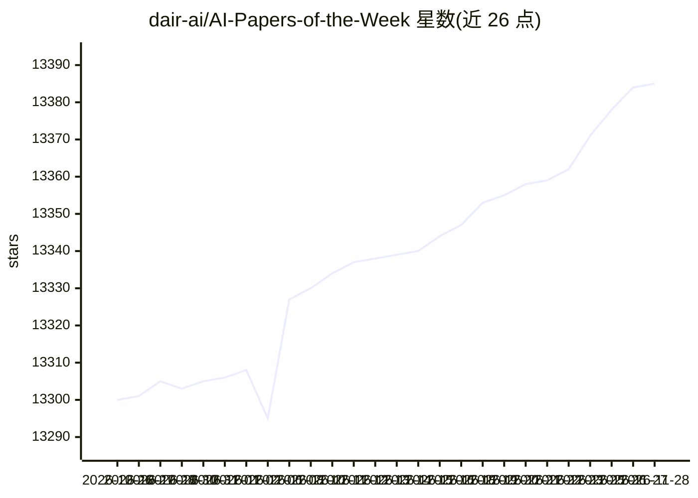

# dair-ai/AI-Papers-of-the-Week

⭐ 13,385 · 推送 2026-11-23 · [GitHub](https://github.com/dair-ai/AI-Papers-of-the-Week) · 组织维护

**面向研究者/开发者的每周精选 AI 论文清单**

由 DAIR.AI 维护的 AI 论文周报索引仓库：按周整理并突出展示每週的 AI/机器学习论文，覆盖 2023 年至今各期列表，读者可通过订阅 newsletter 将每周论文列表发送到邮箱，仓库内按年份（2023-2026）组织各期链接。提供 Twitter 与 Discord 渠道供关注与讨论。仓库本身不含模型或代码，属于论文集合与知识策展类资源。

## 筛选速览

| 维度 | 判定 | 备注 |
|---|---|---|
| AI 角色 | `ai-knowledge` | 知识聚合/清单类 |
| 许可风险 | `none` | — |
| 部署形态 | `None` |  |
| 模型依赖 | — | README 未给出锁定关系 |
| 硬件要求 | — | 无带数字的原话,不猜 |
| 安装摩擦 | `low` | 无编译、无系统依赖或容器化 |
| 成熟度 | — | 结构信号不足 |

## 动量与使用信号

- 维护:`active` — 距上次 push 5.7 天,年发版 0,9 位贡献者
- 涨星:近 1 天 **+2**(自 20261016 起算)
- 安装:github 包 `release-assets` 月下载无数据

## 能力要点

- 按周整理的 AI 论文精选列表，按年份组织（2023 至今）
- 支持 newsletter 订阅，每周论文列表发送至邮箱
- 提供 Twitter 与 Discord 社区渠道

## 适用场景

- 每周跟踪 AI/机器学习领域的论文动态
- 订阅 newsletter 获取论文周报推送
- 回顾查找某一周发布的相关论文

## 场景标签

`精选清单` `科研工具` · 领域:学习与行业

## 证据(README 行号)

> L1: # AI Papers of the Week
> L3: Subscribe to our newsletter to get a weekly list of top AI papers in your inbox.
> L5: At DAIR.AI we ❤️ reading AI papers so we've created this repo to highlight the top AI papers of every week.

## 星数曲线

2026-10-26 13,300 → 2026-11-28 13,385（+85）

---
*卡片 v1 · prompt 1.4 · 生成 2026-11-24 · 置信度 high · 依据 README sha `4ae7a36c294d` · [字段定义](../../DATASET.md)*
