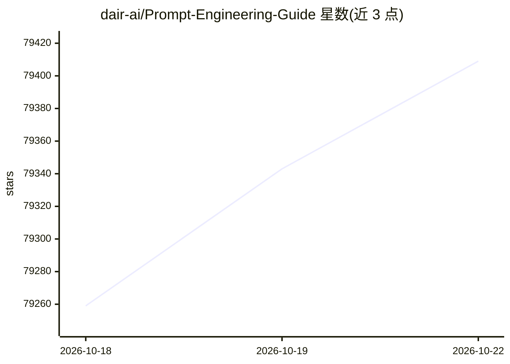

# dair-ai/Prompt-Engineering-Guide

⭐ 79,409 · MDX · MIT · 推送 2026-03-11 · [GitHub](https://github.com/dair-ai/Prompt-Engineering-Guide) · [官网](https://www.promptingguide.ai/) · 组织维护

**面向研究者与开发者的提示工程指南：论文、课程、笔记本与资源合集**

由 DAIR.AI 维护的提示工程指南，汇集提示工程相关论文、学习指南、讲座、引用与工具，覆盖零样本/少样本、思维链、ReAct、RAG 等技术主题，并按模型（ChatGPT、LLaMA、Mistral 等）与应用场景组织章节；提供网页版与 13 种语言翻译，配套 DAIR.AI Academy 的付费课程。本地运行需 Node >=18 与 pnpm，以 Next.js/Nextra 构建文档站点。

## 筛选速览

| 维度 | 判定 | 备注 |
|---|---|---|
| AI 角色 | `ai-knowledge` | 知识聚合/清单类 |
| 许可风险 | `permissive` | MIT |
| 部署形态 | `library` | 以包/库形式分发 |
| 模型依赖 | — | README 未给出锁定关系 |
| 硬件要求 | — | 无带数字的原话,不猜 |
| 安装摩擦 | `low` | 无编译、无系统依赖或容器化 |
| 成熟度 | — | 结构信号不足 |

## 动量与使用信号

- 维护:`declining` — 距上次 push 220.5 天,年发版 0,193 位贡献者
- 涨星:近 1 天 **+47**(自 20261016 起算)
- 安装:npm 包 `next` 月下载 269,758,248

## 能力要点

- 覆盖零样本、思维链、ReAct、ToT、RAG 等提示技术章节
- 支持 13 种语言的翻译版本
- 提供 1 小时视频讲座及配套 notebook 与幻灯片
- 含模型、应用、风险、论文、工具、数据集等分类指引

## 适用场景

- 系统学习提示工程技术与最佳实践
- 为 LLM 应用开发查找提示相关论文与工具
- 本地运行文档站点校对翻译内容

## 场景标签

`提示工程` `教程课程` `精选清单` · 领域:Agent 开发

## 证据(README 行号)

> L5: Prompt engineering is a relatively new discipline for developing and optimizing prompts to efficiently use language 
> L7: Motivated by the high interest in developing with LLMs, we have created this new prompt engineering guide that conta
> L123: 1. Install the dependencies: `pnpm i next react react-dom nextra nextra-theme-docs`

## 星数曲线

2026-10-18 79,259 → 2026-10-22 79,409（+150）

---
*卡片 v1 · prompt 1.4 · 生成 2026-10-18 · 置信度 high · 依据 README sha `77be4acb6abb` · [字段定义](../../DATASET.md)*
