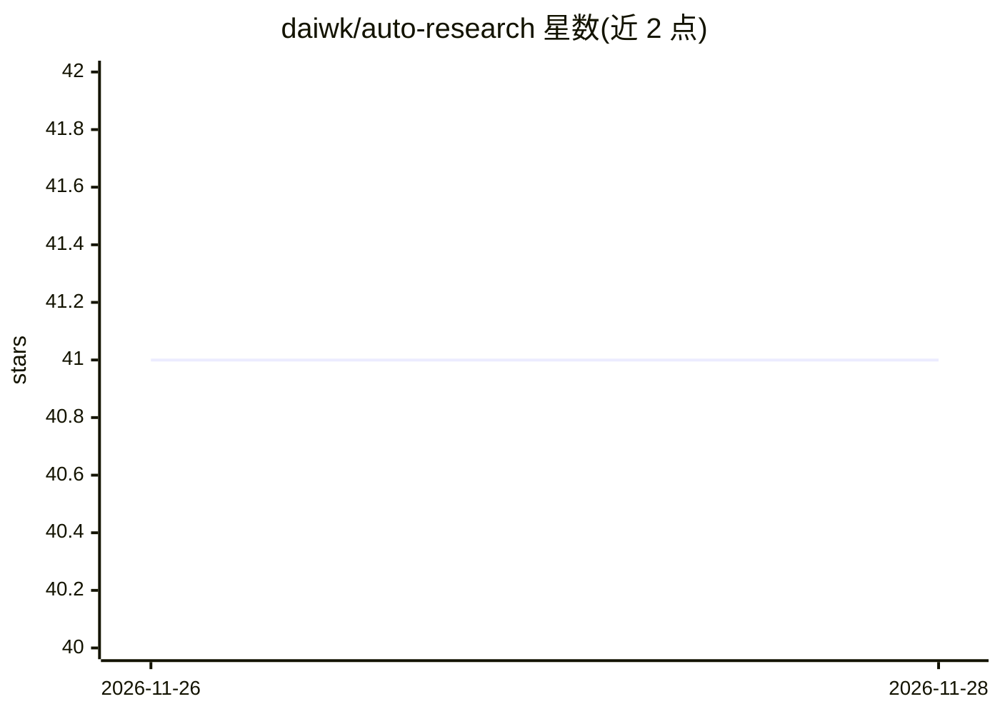

# daiwk/auto-research

⭐ 41 · Python · 推送 2026-11-27 · [GitHub](https://github.com/daiwk/auto-research) · [官网](https://daiwk.github.io/auto-research/) · 个人维护 · 中文 README

**给 AI 研究者：410+ 论文代码实现、精读卡片与实验看板**

以论文学习与验证为核心的知识库：注册 410 个论文代码 adapter，按搜广推、基础模型、LLM 后训练、Agent、多模态、结构化决策六大领域组织；每篇论文配四层递进精读问答卡片，并支持跨论文专题横向对比；公开实验看板以多 Seed 分级评测（L0–L3）呈现结果，保留负向与未复现记录；另提供 evolve/run 命令在白名单算子上做多代模型进化。只读无需安装，运行 CLI 需 Python 3.11+ 与 macOS/Linux。

## 筛选速览

| 维度 | 判定 | 备注 |
|---|---|---|
| AI 角色 | `ai-knowledge` | 知识聚合/清单类 |
| 许可风险 | `none` | — |
| 部署形态 | `None` |  |
| 模型依赖 | — | README 未给出锁定关系 |
| 硬件要求 | — | 无带数字的原话,不猜 |
| 安装摩擦 | `medium` | 含编译或系统依赖之一 |
| 成熟度 | — | 结构信号不足 |

## 能力要点

- 410 个论文 adapter，按保真度分级标注（full_pipeline/core_mechanism/concept_demo）
- 四层学习卡片 + 跨论文专题精读，新论文入库增量更新
- 多 Seed 公开实验看板，保留负结果与未复现边界
- evolve/run 白名单算子多代进化，validation 晋级、隔离 test 终评

## 适用场景

- 我想在复现某篇推荐/LLM 论文前先核对别人的实现与实验结果
- 我想按主题横向比较多篇论文的机制取舍
- 我想在公开数据上运行已实现的论文组件做实验

## 场景标签

`科研工具` `模型评测` · 领域:评测与运维

## 证据(README 行号)

> L1: # Auto Research：410+ 前沿 AI 论文代码实现、公开实验审计与自动进化平台
> L17: 1. **拒绝“伪复现”，严格标注代码保真度（Fidelity Tiers）**：仓库目前注册 **410 个**论文 adapter。严格区分完整训练链路（`full_pipeline`）、核心算法机制（`core_mechan
> L19: 3. **四层问答 + 跨论文专题精读（Deep Dives）**：每篇论文拆解为「基础理解 → 核心机制 → 方法对比 → 实现细节」四层交互卡片；按主题横向对比多篇论文的机制取舍，新论文入库时自动校验并增量更新专题卡片。

## 星数曲线

2026-11-26 41 → 2026-11-28 41（+0）

---
*卡片 v1 · prompt 1.4 · 生成 2026-11-26 · 置信度 high · 依据 README sha `1338712260c9` · [字段定义](../../DATASET.md)*
