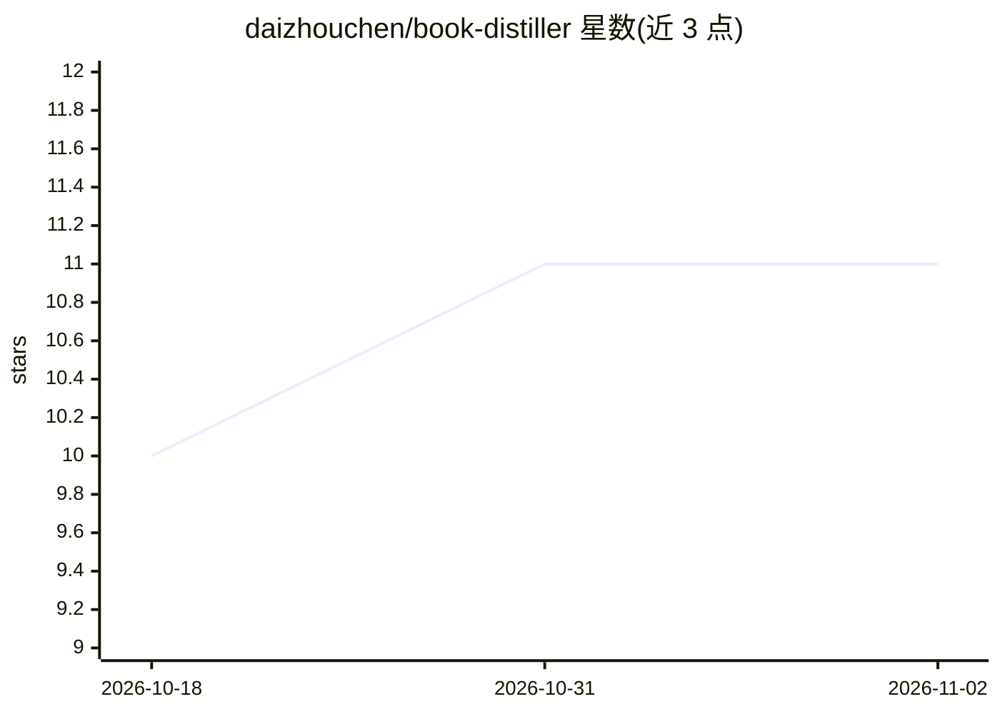

# daizhouchen/book-distiller

⭐ 11 · Python · MIT · 推送 2026-09-27 · [GitHub](https://github.com/daizhouchen/book-distiller) · 个人维护 · 中文 README

**把一本书蒸馏成中文阅读网页的 Claude Code Skill**

供支持本地 Skills 的 AI 助手（如 Claude Code）使用的技能包：脚本负责生成检索计划、结构检查与 HTML 渲染，由 AI 助手读取书籍原文与公开资料，产出 distill.json 和单文件 HTML 报告，含速读、精读、深读三种模式。内容按七种'基因'组织骨架，区分原文、评论与未核证信息，保留来源分级与证据缺口标注。脚本仅用 Python 标准库，需 Git 与 Python 3.7+，模板无需 CDN。

## 筛选速览

| 维度 | 判定 | 备注 |
|---|---|---|
| AI 角色 | `ai-ecosystem` | LLM/agent 周边工具 |
| 许可风险 | `permissive` | MIT |
| 部署形态 | `None` |  |
| 模型依赖 | — | README 未给出锁定关系 |
| 硬件要求 | — | 无带数字的原话,不猜 |
| 安装摩擦 | `low` | 无编译、无系统依赖或容器化 |
| 成熟度 | — | 结构信号不足 |

## 能力要点

- 按七种'基因'组织书籍骨架，区分原文/评论/未核证信息
- 输出 distill.json 与单文件 HTML，三种阅读模式，模板无需 CDN
- 脚本可手动运行：fetch_sources/quality_check/render/visual_check
- 缺原文时只用公开资料并标出证据缺口，不编造章节引文

## 适用场景

- 把读过的书整理成系统化中文笔记网页
- 为深度解读任务生成有来源分级的单文件 HTML 报告
- 快速获取一本书的事实、结构与观点概览

## 场景标签

`知识库管理` · 领域:知识与检索

## 证据(README 行号)

> L9: 这是由 AI 助手执行的 Skill；脚本负责检索计划、渲染和结构检查，不会独立读完一本书。
> L20: 需要支持本地 Skills 的 AI 助手、Git 和 Python 3.7+。本仓库 Python 脚本仅使用标准库；检索资料需要助手的联网工具。
> L22: Claude Code 个人安装（macOS / Linux）：

## 星数曲线

2026-10-18 10 → 2026-11-02 11（+1）

---
*卡片 v1 · prompt 1.4 · 生成 2026-11-02 · 置信度 high · 依据 README sha `6e16e953c9db` · [字段定义](../../DATASET.md)*
