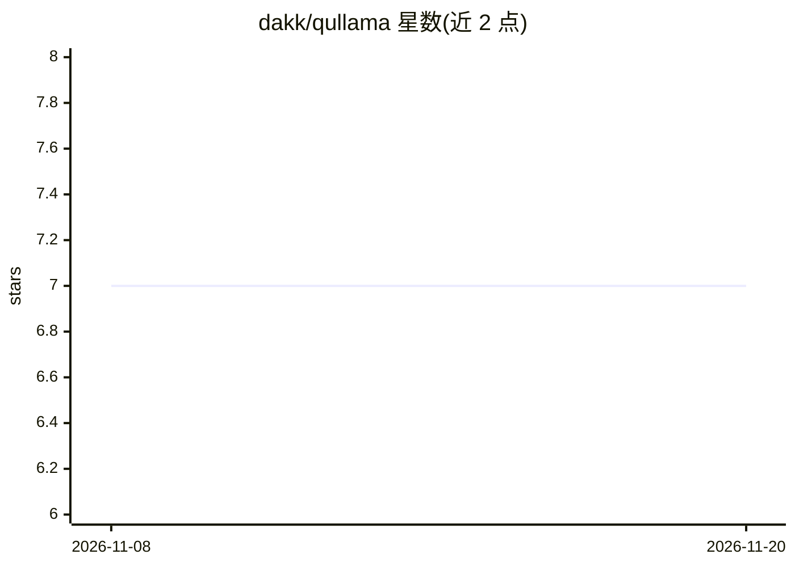

# dakk/qullama

⭐ 7 · Python · MIT · 推送 2026-11-05 · [GitHub](https://github.com/dakk/qullama) · 个人维护

**用量子线路模拟器复用 llama.cpp 运行时执行量子电路**

将量子电路转换为 qgate 格式的 GGUF 模型，门电路作为模型层，通过打补丁的 llama.cpp 的 llama-embedding 可执行文件运行，读取输出态向量。与 qiskit 集成，可作为电路模拟后端。支持门权重量化（F32 至 Q4_0），提供 CPU、CUDA（未测试）和 Vulkan 内核。自述为概念验证，需要进一步开发才能实用。通过 pip 安装，也可通过 Docker 或编译补丁后的 llama.cpp 源码运行。

## 筛选速览

| 维度 | 判定 | 备注 |
|---|---|---|
| AI 角色 | `ai-native` | 本体是模型或模型工具 |
| 许可风险 | `permissive` | MIT |
| 部署形态 | `self-host` | docker 或自建部署 |
| 模型依赖 | local-ok | 支持本地模型 |
| 硬件要求 | — | 无带数字的原话,不猜 |
| 安装摩擦 | `low` | 无编译、无系统依赖或容器化 |
| 成熟度 | `idea` | |

## 能力要点

- 量子电路转 GGUF 模型，经补丁版 llama.cpp 的 llama-embedding 运行并读回态向量
- 支持 F32/F16/BF16/Q8_0/Q4_0 门权重量化以降低内存占用
- 提供 CPU、CUDA（未测试）与 Vulkan 三种内核实现
- 可作为 Qiskit 模拟后端，含 Shor 因数分解完整示例

## 适用场景

- 在 llama.cpp 运行时上模拟小型量子电路并测量概率
- 作为 Qiskit 电路的模拟后端
- 测试量化对量子门矩阵数值精度的影响

## 场景标签

`模型量化` · 领域:训练与推理

## 证据(README 行号)

> L7: `qullama` turns a quantum circuit into a `qgate` GGUF "model" whose layers are the gates themselves; running it with
> L10: The quantum circuit can be run on a quantized version, reducing the memory footprint. This implementation also cont
> L40: Build the circuit directly in Python / Qiskit and use qullama as the simulator backend (see `examples/library_demo.

## 星数曲线

2026-11-08 7 → 2026-11-20 7（+0）

---
*卡片 v1 · prompt 1.4 · 生成 2026-11-20 · 置信度 high · 依据 README sha `64517e4e6543` · [字段定义](../../DATASET.md)*
