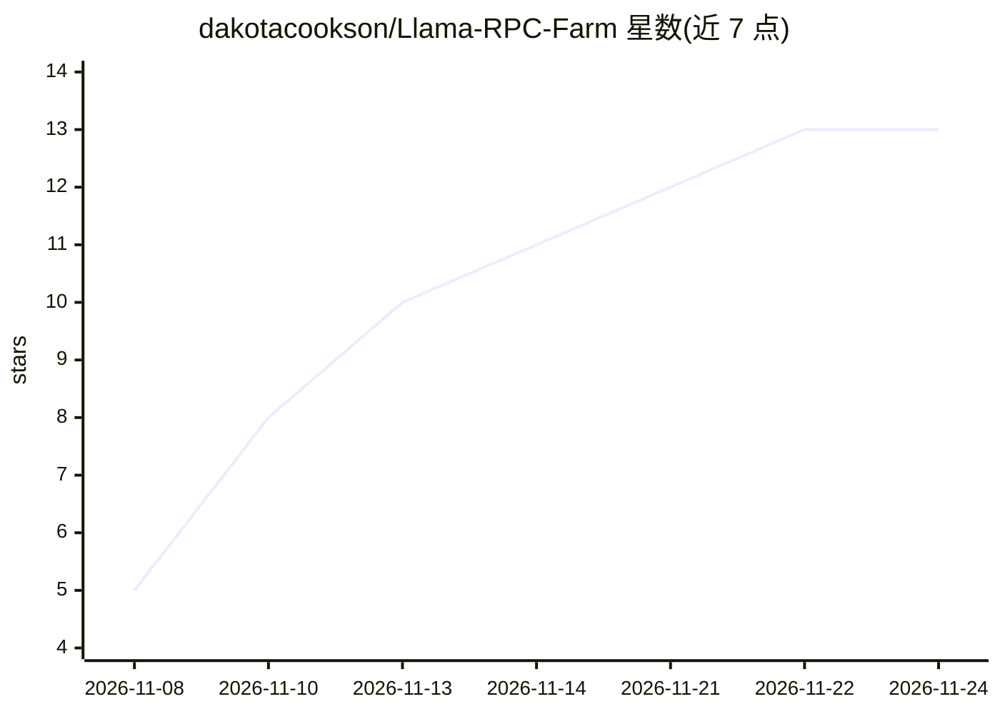

# dakotacookson/Llama-RPC-Farm

⭐ 13 · Python · Apache-2.0 · 推送 2026-11-21 · [GitHub](https://github.com/dakotacookson/Llama-RPC-Farm) · [官网](https://github.com/dakotacookson/Llama-RPC-Farm/blob/main/README.md) · 个人维护

**把家用多台机器聚合成 llama.cpp 集群的 Web 管理面板**

面向在家有多台不同系统、不同显卡机器的用户：通过 Web 面板将各机器以 llama.cpp RPC 组成集群，池化 GPU 与内存，并经 llama-swap 按需启停多个模型、对外提供单一 OpenAI 兼容端点。提供 Flow Visualizer 实时展示逐 tensor 的设备分配、模型编辑器、Hugging Face 浏览下载、按用户模型授权与 API key。仅限局域网/VPN 使用；不做公共多租户、不引入新推理运行时。提供 Linux/macOS/Windows 安装包及源码安装脚本。

## 筛选速览

| 维度 | 判定 | 备注 |
|---|---|---|
| AI 角色 | `ai-ecosystem` | LLM/agent 周边工具 |
| 许可风险 | `permissive` | Apache-2.0 |
| 部署形态 | `desktop` | 安装包/桌面程序 |
| 模型依赖 | local-ok | 支持本地模型 |
| 硬件要求 | `cpu-ok` | |
| 安装摩擦 | `medium` | 含编译或系统依赖之一 |
| 成熟度 | — | 结构信号不足 |

## 能力要点

- 通过 llama.cpp RPC 将多台异构机器池化为一个端点
- llama-swap 按需启停模型并释放 GPU，支持分组策略
- Flow Visualizer 实时展示逐 tensor 的设备分配
- 内置 Hugging Face 浏览器，按 GGUF 量化过滤并下载

## 适用场景

- 把家里闲置 GPU 机器合并成一个大模型可跑的集群
- 在本地通过 OpenAI 兼容端点按需调用多个 GGUF 模型
- 混用 Linux/Windows/macOS 机器组成统一推理入口

## 场景标签

`推理引擎` · 领域:训练与推理

## 证据(README 行号)

> L241: This project is an orchestration layer only — the engines are the real
> L26:  or automatic device discovery with its own scheduler. The farm drives

## 星数曲线

2026-11-08 5 → 2026-11-24 13（+8）

---
*卡片 v1 · prompt 1.4 · 生成 2026-11-18 · 置信度 high · 依据 README sha `3140d5018494` · [字段定义](../../DATASET.md)*
