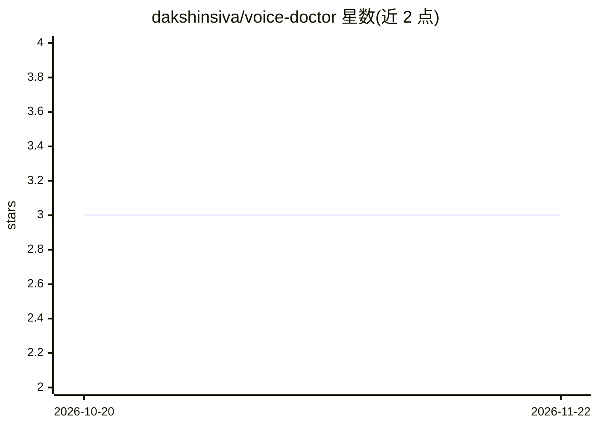

# dakshinsiva/voice-doctor

⭐ 3 · Python · MIT · 推送 2026-10-27 · [GitHub](https://github.com/dakshinsiva/voice-doctor) · 个人维护

**面向印度语音 agent 的体检与修复 Claude Code 技能**

以 Claude Code skill 形式分发的语音 agent 审计工具：读取 agent 的 prompt、配置、代码与真实通话记录，检测导致体验差的配置与文案问题（如 90 秒截断默认值、抢话的 endpointing、罗马化 Hindi 送至 Sarvam 语音），并输出重写后的 system prompt、config 变更文件与测试通话清单。支持 Bolna、Vapi、Retell、LiveKit、Pipecat 平台，覆盖 Hindi、Hinglish、Kannada 等印度语言的脚本与语码混用规范。检查脚本为纯 Python 3 无依赖，工具本身只读，修改需用户确认后经控制台、Bolna MCP 或 CLI 应用。

## 筛选速览

| 维度 | 判定 | 备注 |
|---|---|---|
| AI 角色 | `ai-ecosystem` | LLM/agent 周边工具 |
| 许可风险 | `permissive` | MIT |
| 部署形态 | `None` |  |
| 模型依赖 | locked-api |  |
| 硬件要求 | — | 无带数字的原话,不猜 |
| 安装摩擦 | `low` | 无编译、无系统依赖或容器化 |
| 成熟度 | — | 结构信号不足 |

## 能力要点

- 三类检查：Prompt（文案/脚本/数字格式）、Config（endpointing/计时器/语音语言支持）、Calls（延迟、打断、话费去向）
- 针对印度语言场景：Devanagari 书写规范、₹/lakh/crore 数字格式、平台语言支持缺口表
- 输出 report.md、重写 prompt、config-changes.json、重评分后的 agent.fixed.json 与 test-calls.md
- 提供 GitHub Actions CI 检查，PR 内联显示 findings

## 适用场景

- 上线前对 Bolna/Vapi 上的印度语音客服 agent 做配置与文案体检
- 按通话执行记录定位通话截断、抢话和话费浪费原因
- 把语音 agent 的 prompt 和配置纳入 git 并在 PR 中拦截退化改动

## 场景标签

`提示工程` `模型评测` · 领域:Agent 开发

## 证据(README 行号)

> L7: A Claude Code skill that listens to your agent the way a caller does (prompt, config, code and real calls), finds wh
> L8: Works on **Bolna, Vapi, Retell, LiveKit and Pipecat**, with **Sarvam**, Deepgram, ElevenLabs and Cartesia voices ove
> L127: |Config|Bolna agent JSON, Vapi assistant, Retell agent + LLM, or LiveKit / Pipecat Python code (findings with `fil

## 星数曲线

2026-10-20 3 → 2026-11-22 3（+0）

---
*卡片 v1 · prompt 1.4 · 生成 2026-11-22 · 置信度 high · 依据 README sha `4f3dbe5afabe` · [字段定义](../../DATASET.md)*
