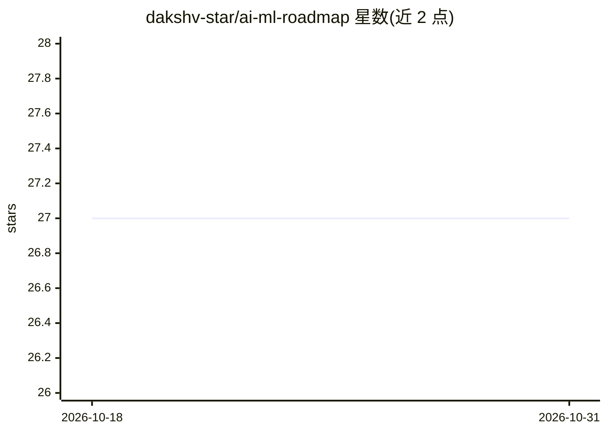

# dakshv-star/ai-ml-roadmap

⭐ 27 · HTML · MIT · 推送 2026-04-23 · [GitHub](https://github.com/dakshv-star/ai-ml-roadmap) · [官网](https://dakshv-star.github.io/ai-ml-roadmap/) · 个人维护

**面向初学者的 AI/ML 自学路线图网站**

一个用 HTML/CSS/JavaScript 构建的静态学习路线图站点：把 AI/ML 学习过程组织为从基础到进阶的分步路径，收录筛选后的免费学习资源，提供简洁界面、内置进度跟踪，以及 XP、连续打卡（Streak）和等级系统。面向学生、转行者和自学者。通过 GitHub Pages 提供在线访问，使用方式为访问网站并按模块顺序学习，无需本地安装。

## 筛选速览

| 维度 | 判定 | 备注 |
|---|---|---|
| AI 角色 | `ai-knowledge` | 知识聚合/清单类 |
| 许可风险 | `permissive` | MIT |
| 部署形态 | `None` |  |
| 模型依赖 | — | README 未给出锁定关系 |
| 硬件要求 | — | 无带数字的原话,不猜 |
| 安装摩擦 | `low` | 无编译、无系统依赖或容器化 |
| 成熟度 | — | 结构信号不足 |

## 能力要点

- 从基础到进阶的结构化学习路径
- 内置进度跟踪与 XP/连续打卡/等级系统
- 全部收录资源为免费公开资源

## 适用场景

- 初学者按顺序自学 AI/ML 基础知识
- 转行者寻找免费且有条理的学习路径
- 跟踪自己的学习进度保持连续性

## 场景标签

`教程课程` · 领域:学习与行业

## 证据(README 行号)

> L4: A structured, self-paced roadmap designed to help beginners navigate the field of Artificial Intelligence and Machin
> L18: * Structured progression from fundamentals to advanced topics

## 星数曲线

2026-10-18 27 → 2026-10-31 27（+0）

---
*卡片 v1 · prompt 1.4 · 生成 2026-10-26 · 置信度 high · 依据 README sha `cbd10c7de7b4` · [字段定义](../../DATASET.md)*
