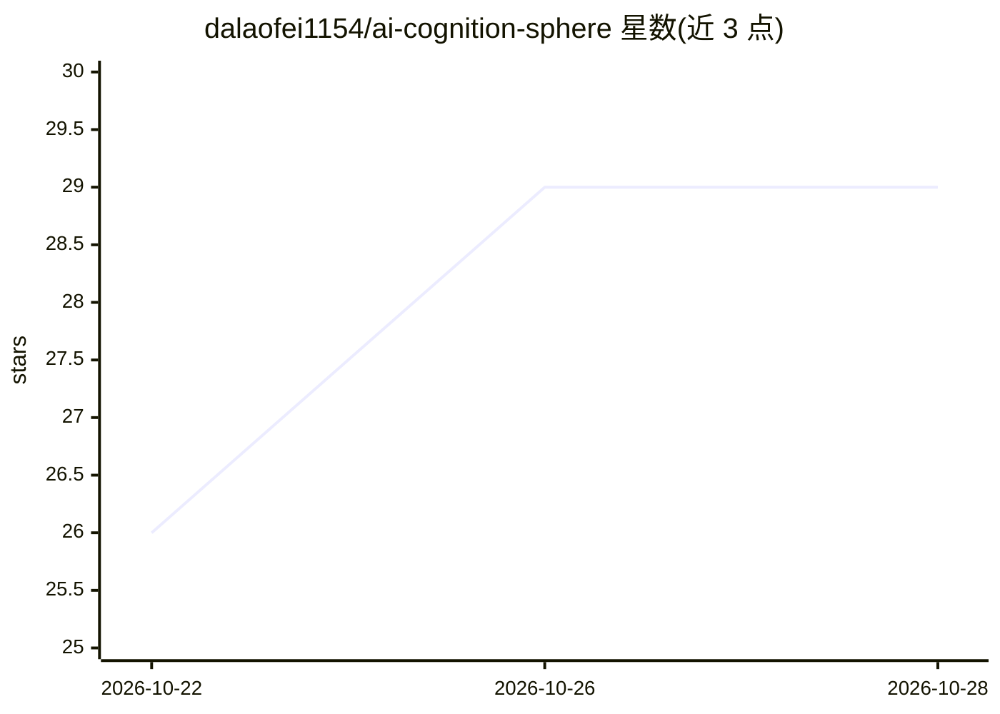

# dalaofei1154/ai-cognition-sphere

⭐ 29 · TypeScript · NOASSERTION · 推送 2026-08-11 · [GitHub](https://github.com/dalaofei1154/ai-cognition-sphere) · [官网](https://ai-cognition-sphere.ai-cognition-sphere.workers.dev/) · 个人维护 · 中文 README

**可交互的 AI 认知结构图谱：从生成式 AI 到物理 AI 的概念导航**

一个基于 Three.js/WebGL 的交互式双语认知地图：以 3D 球体组织 179 个概念节点、8 个认知层级与 215 条语义关系，从表层可见能力向内推进到模型机制、生产系统、物理行动、失效条件、基础理论与未解边界。每个节点提供定义、作者诠释、实践意义、待续问题、编辑状态与参考来源，另带 50 节点作者路径、约 60 秒确定性导览、无需 WebGL 的可读索引，以及免安装免网络的离线版（单 HTML 文件，Windows/macOS 通用）。面向探索 AI 的学习者和有实践经验的从业者，内容与代码分离，支持社区贡献路径与修正。本地开发需 Node.js 22.13+。

## 筛选速览

| 维度 | 判定 | 备注 |
|---|---|---|
| AI 角色 | `ai-knowledge` | 知识聚合/清单类 |
| 许可风险 | `none` | NOASSERTION |
| 部署形态 | `desktop` | 安装包/桌面程序 |
| 模型依赖 | — | README 未给出锁定关系 |
| 硬件要求 | — | 无带数字的原话,不猜 |
| 安装摩擦 | `low` | 无编译、无系统依赖或容器化 |
| 成熟度 | — | 结构信号不足 |

## 能力要点

- 179 个概念节点、8 个认知层级、215 条语义关系的 3D 球体结构
- 每个节点含双语定义、作者诠释、来源与编辑状态
- 50 节点作者路径与约 60 秒确定性导览
- 免安装的通用离线版与无需 WebGL 的可读索引

## 适用场景

- 初学 AI 时获得整体认知结构与方向感
- 查找并阅读 AI 概念的定义、诠释与参考来源
- 有 AI 项目经验者对照作者路径检视自己的认知转折点

## 场景标签

`教程课程` · 领域:学习与行业

## 证据(README 行号)

> L70: - **179 concept nodes** spanning visible capabilities, building methods, model mechanisms, production systems, real
> L75: - **Bilingual content and sources** for every node: definition, authorial interpretation, practical significance, a

## 星数曲线

2026-10-22 26 → 2026-10-28 29（+3）

---
*卡片 v1 · prompt 1.4 · 生成 2026-10-27 · 置信度 high · 依据 README sha `e6068c911bbd` · [字段定义](../../DATASET.md)*
