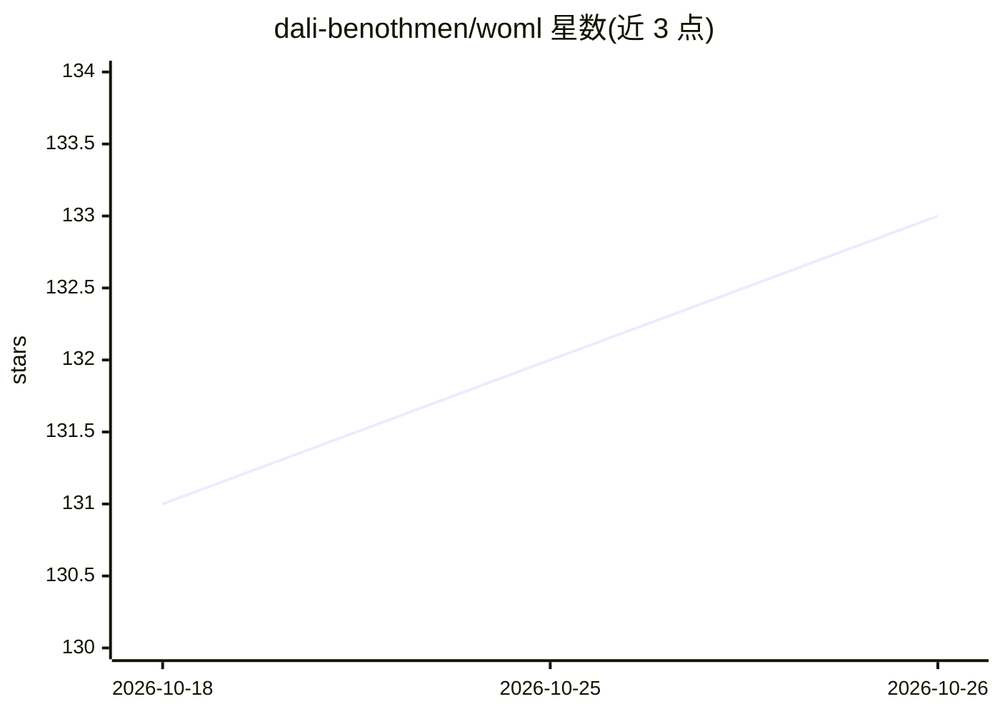

# dali-benothmen/woml

⭐ 133 · Rust · NOASSERTION · 推送 2026-10-25 · [GitHub](https://github.com/dali-benothmen/woml) · [官网](https://woml.org) · 个人维护

**用 HTML 风格标记语言编写可持久化自动化工作流的运行时**

WOML 是一种可执行的工作流标记语言加 Rust 运行时：用 HTML 风格标记描述触发器、步骤、并行、审批、重试等，复杂逻辑内嵌 JavaScript/TypeScript；事件溯源引擎记录尝试、状态与执行历史，支持持久等待、信号恢复、补偿清理、锁与围栏等运行时策略。以全局 CLI（npm/bun/pnpm）安装，自动选择各平台原生 Rust 引擎，需 Bun 1.3.14+。支持编排 LLM/工具调用作为受管步骤，并供编码 agent 生成、用 woml check 校验。

## 筛选速览

| 维度 | 判定 | 备注 |
|---|---|---|
| AI 角色 | `ai-ecosystem` | LLM/agent 周边工具 |
| 许可风险 | `none` | NOASSERTION |
| 部署形态 | `library` | 以包/库形式分发 |
| 模型依赖 | — | README 未给出锁定关系 |
| 硬件要求 | — | 无带数字的原话,不猜 |
| 安装摩擦 | `low` | 无编译、无系统依赖或容器化 |
| 成熟度 | — | 结构信号不足 |

## 能力要点

- HTML 风格标记描述工作流，内嵌 JavaScript 实现逻辑
- 事件溯源的持久引擎：重试、恢复、持久等待与信号、补偿清理
- 触发器覆盖 webhook/定时/Slack/Telegram/Discord/WhatsApp
- woml check 用真实编译器校验，供 AI agent 生成工作流

## 适用场景

- 把业务流程、数据管道写成可版本控制的自动化文件
- 让 AI agent 生成并校验工作流，人类在 PR 中审查
- 自托管运行长时任务、审批链与事件驱动服务

## 场景标签

`工作流自动化` · 领域:效率与自动化

## 证据(README 行号)

> L14: WOML is an open, executable format for durable workflow applications. It lets you describe a workflow with readable
> L39: - **AI-friendly** — coding agents can generate WOML, validate it with the real compiler, and leave a workflow human
> L58: WOML can also orchestrate AI systems themselves. An LLM or tool call can run as a supervised step, specialist agent

## 星数曲线

2026-10-18 131 → 2026-10-26 133（+2）

---
*卡片 v1 · prompt 1.4 · 生成 2026-10-22 · 置信度 high · 依据 README sha `d7b597ac0cf9` · [字段定义](../../DATASET.md)*
