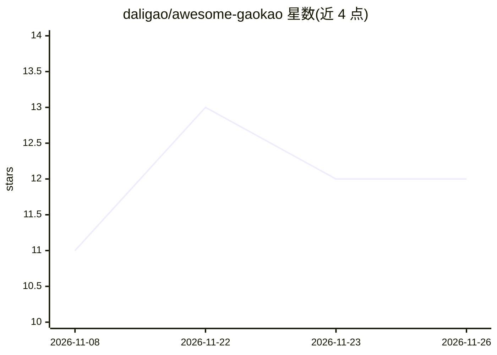

# daligao/awesome-gaokao

⭐ 12 · NOASSERTION · 推送 2026-08-12 · [GitHub](https://github.com/daligao/awesome-gaokao) · 个人维护 · 中文 README

**面向高考考生与教育者的开源备考资源精选清单**

收录面向中国高考的开源项目与资源清单，按备考工具、数学、物理、英语、生物、综合资料、学习方法、志愿填报、AI 辅助、AI 基准数据等类别组织，每条附简介与星标数。内容覆盖真题库（如 1952–2026 数学真题）、交互学习工具、间隔重复等方法论、志愿推荐系统，以及 GAOKAO-Bench 等评测数据集。清单本身不提供安装与运行说明，以 CC0 许可发布，并通过 Contributing 章节接受贡献。

## 筛选速览

| 维度 | 判定 | 备注 |
|---|---|---|
| AI 角色 | `ai-knowledge` | 知识聚合/清单类 |
| 许可风险 | `none` | NOASSERTION |
| 部署形态 | `None` |  |
| 模型依赖 | — | README 未给出锁定关系 |
| 硬件要求 | — | 无带数字的原话,不猜 |
| 安装摩擦 | `low` | 无编译、无系统依赖或容器化 |
| 成熟度 | — | 结构信号不足 |

## 能力要点

- 按 10+ 个主题分类组织开源备考资源
- 收录真题库、刷题系统、LaTeX 试卷模板等工具类项目
- 含 GAOKAO-Bench、GAOKAO-MM、AGIEval 等高考 AI 基准数据集条目
- 学习方法章节整理间隔重复、主动回忆、费曼技巧等策略

## 适用场景

- 为各科备考查找开源真题库和刷题工具
- 老师自制模拟卷时找试卷排版模板
- 查找高考题构成的大模型评测数据集
- 了解志愿填报相关的开源推荐系统

## 场景标签

`精选清单` · 领域:学习与行业

## 证据(README 行号)

> L3: > 高考备考资源精选 · 真题库、备考工具、学习方法、逻辑思维、AI 辅助、志愿填报，全部开源免费
> L5: A curated list of open-source tools, exam banks, learning methods, and resources for China's National College Entran

## 星数曲线

2026-11-08 11 → 2026-11-26 12（+1）

---
*卡片 v1 · prompt 1.4 · 生成 2026-11-18 · 置信度 high · 依据 README sha `2d0de32ea56d` · [字段定义](../../DATASET.md)*
