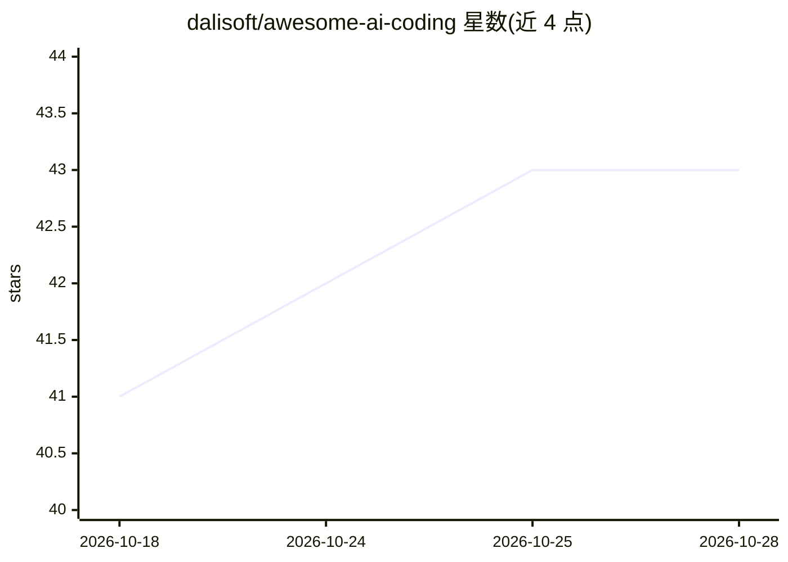

# dalisoft/awesome-ai-coding

⭐ 43 · MIT · 推送 2026-10-26 · [GitHub](https://github.com/dalisoft/awesome-ai-coding) · 个人维护

**AI 编程工具价格对比清单：按最低套餐价排序编目**

个人维护的 awesome 类策展清单，收录 AI 编程相关产品与服务的价格信息，按类别组织：订阅制服务商（Claude Code、ChatGPT Codex、Google AI 等）、智能/融合模型路由器、AI IDE 与编辑器、插件扩展、SaaS 网页应用、CLI 工具及周边 Tools。每类以表格列出最低套餐价、试用、用量限制与是否开源，并附作者信任徽章（✅/⚠️/⛔️ 等）标注验证状态。README 为英文，MIT 许可。

## 筛选速览

| 维度 | 判定 | 备注 |
|---|---|---|
| AI 角色 | `ai-knowledge` | 知识聚合/清单类 |
| 许可风险 | `permissive` | MIT |
| 部署形态 | `None` |  |
| 模型依赖 | — | README 未给出锁定关系 |
| 硬件要求 | — | 无带数字的原话,不猜 |
| 安装摩擦 | `low` | 无编译、无系统依赖或容器化 |
| 成熟度 | — | 结构信号不足 |

## 能力要点

- 覆盖代理服务、订阅、路由器、IDE、扩展、SaaS、CLI 等多类目价格表
- 每条目列出最低套餐价、试用额度、用量限制与开源状态
- 作者信任徽章体系标注条目验证状态
- 表格按最低套餐价格排序

## 适用场景

- 对比各家 AI 编程订阅服务的价格与用量限制
- 挑选 BYOK 或开源的 AI 编程 CLI/编辑器
- 了解模型路由器（Auto/Fusion）类服务的选择

## 场景标签

`精选清单` · 领域:学习与行业

## 证据(README 行号)

> L3: A curated list of AI-powered CLI, code editor and IDE's categorized by their usage,
> L4: sorted by minimal plan price.

## 星数曲线

2026-10-18 41 → 2026-10-28 43（+2）

---
*卡片 v1 · prompt 1.4 · 生成 2026-10-25 · 置信度 high · 依据 README sha `a60cf5e7c0da` · [字段定义](../../DATASET.md)*
