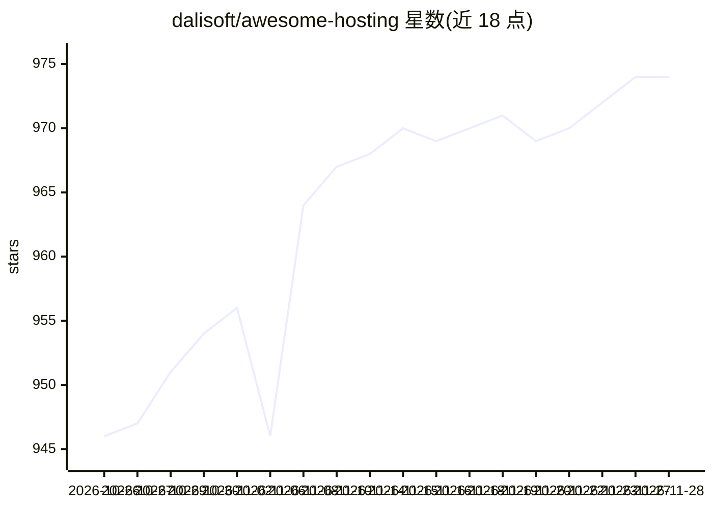

# dalisoft/awesome-hosting

⭐ 974 · MIT · 推送 2026-11-27 · [GitHub](https://github.com/dalisoft/awesome-hosting) · 个人维护

**按最低套餐价格排序的托管平台策展清单**

以表格形式收录各类托管服务平台，按最低套餐价格排序，分类涵盖 Web 服务平台、BaaS、容器托管、Serverless（Lambda）、Node.js 托管、静态站点、WordPress 与 VPS 共八个板块；每个条目列出最低价格、试用/免费额度、是否开源及 Lambda 支持等字段，并用徽章标注作者的可信度评级（可信/不可信/不推荐/已停止运营/未验证）。README 无安装与运行说明，属于纯清单型资源。

## 筛选速览

| 维度 | 判定 | 备注 |
|---|---|---|
| AI 角色 | `ai-knowledge` | 知识聚合/清单类 |
| 许可风险 | `permissive` | MIT |
| 部署形态 | `None` |  |
| 模型依赖 | — | README 未给出锁定关系 |
| 硬件要求 | — | 无带数字的原话,不猜 |
| 安装摩擦 | `low` | 无编译、无系统依赖或容器化 |
| 成熟度 | — | 结构信号不足 |

## 能力要点

- 八个托管类别：Web 平台、BaaS、容器、Lambda、Node.js、静态、WordPress、VPS
- 条目按最低套餐价格排序，标注试用与免费额度
- 可信度徽章体系（可信/不推荐/已停止运营等）
- 同一作者维护 awesome-storage、awesome-ai-coding 等系列清单

## 适用场景

- 为新项目挑选价格最低的托管平台
- 查找提供免费额度或试用额度的高校方案
- 对比各平台是否开源或支持自托管

## 场景标签

`精选清单` · 领域:学习与行业

## 证据(README 行号)

> L3: List of awesome hosting sorted by minimal plan price
> L25: ## Contents

## 星数曲线

2026-10-26 946 → 2026-11-28 974（+28）

---
*卡片 v1 · prompt 1.4 · 生成 2026-11-28 · 置信度 high · 依据 README sha `939c7e5c0503` · [字段定义](../../DATASET.md)*
