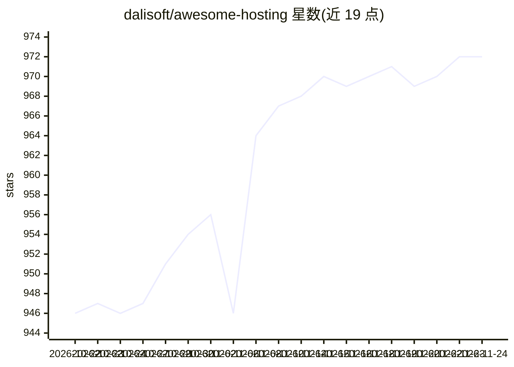

# dalisoft/awesome-hosting

⭐ 972 · MIT · 推送 2026-11-23 · [GitHub](https://github.com/dalisoft/awesome-hosting) · 个人维护

**按最低套餐价格排序的主机服务商清单**

一个 awesome 系列清单仓库：收集各类托管/主机服务，并按最低套餐价格排序展示，覆盖 Web 服务平台、BaaS、容器托管、Serverless（Lambda）、Node.js、静态站点、WordPress、VPS、数据库等分类；每个条目列出最低价、试用、免费额度、开源与否等字段，并附作者信誉徽章（✅/⚠️/⛔️/🛑）标注可信度。另维护 awesome-storage、awesome-ai-coding 等姊妹清单。

## 筛选速览

| 维度 | 判定 | 备注 |
|---|---|---|
| AI 角色 | `ai-knowledge` | 知识聚合/清单类 |
| 许可风险 | `permissive` | MIT |
| 部署形态 | `None` |  |
| 模型依赖 | — | README 未给出锁定关系 |
| 硬件要求 | — | 无带数字的原话,不猜 |
| 安装摩擦 | `low` | 无编译、无系统依赖或容器化 |
| 成熟度 | — | 结构信号不足 |

## 能力要点

- 按最低套餐价格排序的托管服务对比表
- 覆盖 VPS、BaaS、容器、Serverless、静态托管等多类别
- 作者信誉徽章系统（可信/警告/不推荐/已停运）
- 条目字段含试用、免费额度、开源与否

## 适用场景

- 部署应用前按预算查找合适的托管平台
- 比较各 VPS 提供商的最低套餐与免费额度
- 寻找支持自托管的 BaaS 或容器平台

## 场景标签

`精选清单` · 领域:学习与行业

## 证据(README 行号)

> L3: List of awesome hosting sorted by minimal plan price
> L31: |Name|Minimal plan|Trial|Free|Open Source|Type|Lambda|

## 星数曲线

2026-10-22 946 → 2026-11-24 972（+26）

---
*卡片 v1 · prompt 1.4 · 生成 2026-11-24 · 置信度 high · 依据 README sha `c43bd939c7b2` · [字段定义](../../DATASET.md)*
