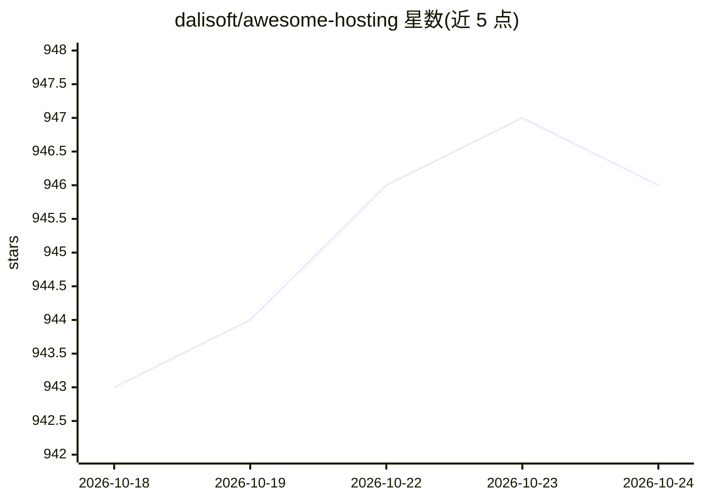

# dalisoft/awesome-hosting

⭐ 946 · MIT · 推送 2026-10-22 · [GitHub](https://github.com/dalisoft/awesome-hosting) · 个人维护

**按最低套餐价格排序的云托管服务清单（Web/BaaS/容器/VPS/数据库等）**

个人维护的 awesome 类托管服务聚合清单：按 Web 服务、BaaS、容器、Lambda、Node.js、静态站点、WordPress、VPS、托管数据库等类别组织，每个条目列出名称、最低套餐价格、试用额度、免费额度与开源情况，并附作者信任状态标记（✅/⚠️/⛔️/❌/🛑）。主题标签显示另含 AI/LLM 推理托管与免费托管等类别（部分在展示窗口外）。条目为表格化链接与价格信息，无代码安装。

## 筛选速览

| 维度 | 判定 | 备注 |
|---|---|---|
| AI 角色 | `ai-knowledge` | 知识聚合/清单类 |
| 许可风险 | `permissive` | MIT |
| 部署形态 | `None` |  |
| 模型依赖 | — | README 未给出锁定关系 |
| 硬件要求 | — | 无带数字的原话,不猜 |
| 安装摩擦 | `low` | 无编译、无系统依赖或容器化 |
| 成熟度 | — | 结构信号不足 |

## 能力要点

- 按最低套餐价格排序的多类别托管服务清单
- 每条目标注试用额度、免费额度与开源情况
- 作者信任状态标记体系（✅/⚠️/⛔️/❌/🛑）

## 适用场景

- 挑选有免费额度的 VPS 或静态站点托管
- 比较各平台最低价格与试用政策
- 查找支持自托管的 BaaS/容器平台

## 场景标签

`精选清单` · 领域:学习与行业

## 证据(README 行号)

> L3: List of awesome hosting sorted by minimal plan price
> L25: ## Contents

## 星数曲线

2026-10-18 943 → 2026-10-24 946（+3）

---
*卡片 v1 · prompt 1.4 · 生成 2026-10-21 · 置信度 high · 依据 README sha `696d6daa540c` · [字段定义](../../DATASET.md)*
