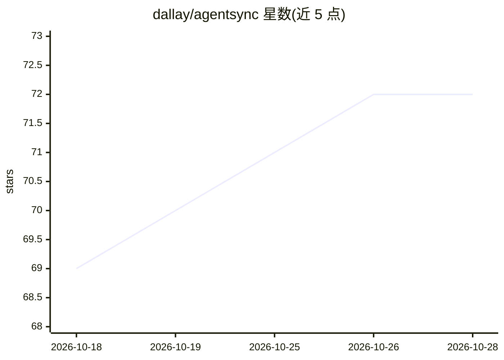

# dallay/agentsync

⭐ 72 · Rust · MIT · 推送 2026-10-26 · [GitHub](https://github.com/dallay/agentsync) · [官网](https://dallay.github.io/agentsync/) · 个人维护

**CLI 工具：用符号链接把 AI agent 配置同步到多个编码助手**

Rust 编写的命令行工具，将 `.agents/` 目录作为唯一配置源，通过符号链接把 agent 指令、命令、技能与 MCP 服务器配置同步到 Claude Code、GitHub Copilot、Cursor、Gemini CLI 等多个 AI 编码助手各自的配置位置。提供 init/apply/status/revert 命令，支持 TOML 配置、.gitignore 自动管理、现有文件备份、merge 策略，并可从 dallay/agents-skills 等集合安装技能。跨 Linux/macOS/Windows，以 npm 包、cargo、预编译二进制或源码构建方式分发。

## 筛选速览

| 维度 | 判定 | 备注 |
|---|---|---|
| AI 角色 | `ai-ecosystem` | LLM/agent 周边工具 |
| 许可风险 | `permissive` | MIT |
| 部署形态 | `desktop` | 安装包/桌面程序 |
| 模型依赖 | — | README 未给出锁定关系 |
| 硬件要求 | — | 无带数字的原话,不猜 |
| 安装摩擦 | `medium` | 含编译或系统依赖之一 |
| 成熟度 | — | 结构信号不足 |

## 能力要点

- `.agents/` 单一配置源，symlink 同步到 9+ 个 agent 工具的配置位置
- 在 agentsync.toml 定义一次 MCP servers，自动生成各 agent 格式的配置文件
- 支持 symlink/symlink-contents/nested-glob/module-map 四种目标类型
- 可从 dallay/agents-skills 集合或外部来源安装技能

## 适用场景

- 多个 AI 编码助手共用一套项目指令与命令，避免重复维护
- 在团队中统一 MCP 服务器配置并随项目安装自动同步
- monorepo 中各子目录的 AGENTS.md 按模式批量生成符号链接

## 场景标签

 · 领域:开发者工具/AI agent 配置管理

## 证据(README 行号)

> L22: A fast, portable CLI tool for synchronizing AI agent configurations and MCP servers across multiple
> L262: AgentSync can automatically generate MCP configuration files for supported agents (Claude Code,

## 星数曲线

2026-10-18 69 → 2026-10-28 72（+3）

---
*卡片 v1 · prompt 1.4 · 生成 2026-10-24 · 置信度 high · 依据 README sha `0317b154722a` · [字段定义](../../DATASET.md)*
