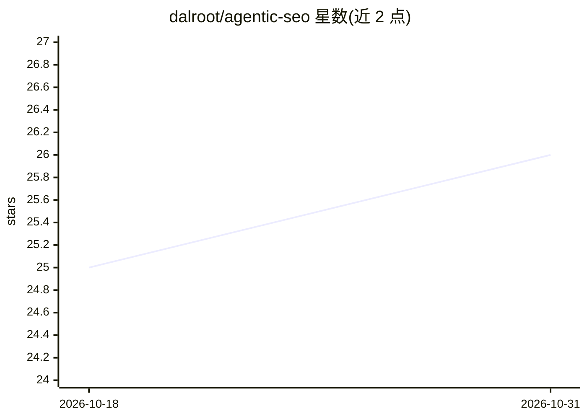

# dalroot/agentic-seo

⭐ 26 · Python · MIT · 推送 2026-10-27 · [GitHub](https://github.com/dalroot/agentic-seo) · [官网](https://T4wroot.github.io/agentic-seo/) · 个人维护 · 中文 README

**面向 AI 编程助手的 SEO 技能包：16 子技能+89 脚本做审计优化**

面向 AI 编程助手与自主 Agent（Claude Code、Cursor、Antigravity、Windsurf 等 9 种 IDE/CLI）安装的 LLM-first SEO 技能与自动化工具包，含 16 个子技能、10 个专家 Agent、89 个 Python 脚本。工作流为证据优先：脚本抓取页面证据后由 LLM 分析，按统一 rubric 输出 Finding/Evidence/Impact/Fix 结构报告与行动方案，覆盖技术审计、GEO/AEO、Schema、GitHub 仓库 SEO 等。安装器按各 IDE 原生格式分发，CI 校验清单一致性与参考资料新鲜度。

## 筛选速览

| 维度 | 判定 | 备注 |
|---|---|---|
| AI 角色 | `ai-ecosystem` | LLM/agent 周边工具 |
| 许可风险 | `permissive` | MIT |
| 部署形态 | `library` | 以包/库形式分发 |
| 模型依赖 | — | README 未给出锁定关系 |
| 硬件要求 | — | 无带数字的原话,不猜 |
| 安装摩擦 | `low` | 无编译、无系统依赖或容器化 |
| 成熟度 | — | 结构信号不足 |

## 能力要点

- 16 个子技能覆盖技术审计、内容 E-E-A-T、GEO/AEO、Schema、GitHub SEO 等
- 89 个 Python 脚本（审计运行器、PageSpeed、爬取、JSON-LD 校验、报告生成等）
- 统一 LLM 审计 rubric：Finding/Evidence/Impact/Fix、严重度与置信度标注
- 安装器为 Claude Code、Cursor、Windsurf、Copilot 等 9 种 IDE 输出原生格式

## 适用场景

- 在 AI 编程助手中一句话触发整站 SEO 审计并生成行动方案
- 优化网站在 ChatGPT Search、Perplexity、Google AI Overviews 中的引用可见性（GEO/AEO）
- 对 GitHub 仓库做元数据、README 与查询排名的 SEO 分析
- 生成并校验 JSON-LD 结构化数据

## 场景标签

 · 领域:开发者工具/SEO 自动化

## 证据(README 行号)

> L12: **Agentic SEO** is an LLM-first SEO engineering skill and automation toolkit for AI coding assistants and autonomou
> L18: The installer ships native formats for each tool — not just a generic copy:

## 星数曲线

2026-10-18 25 → 2026-10-31 26（+1）

---
*卡片 v1 · prompt 1.4 · 生成 2026-10-27 · 置信度 mid · 依据 README sha `f66c06a06cc7` · [字段定义](../../DATASET.md)*
