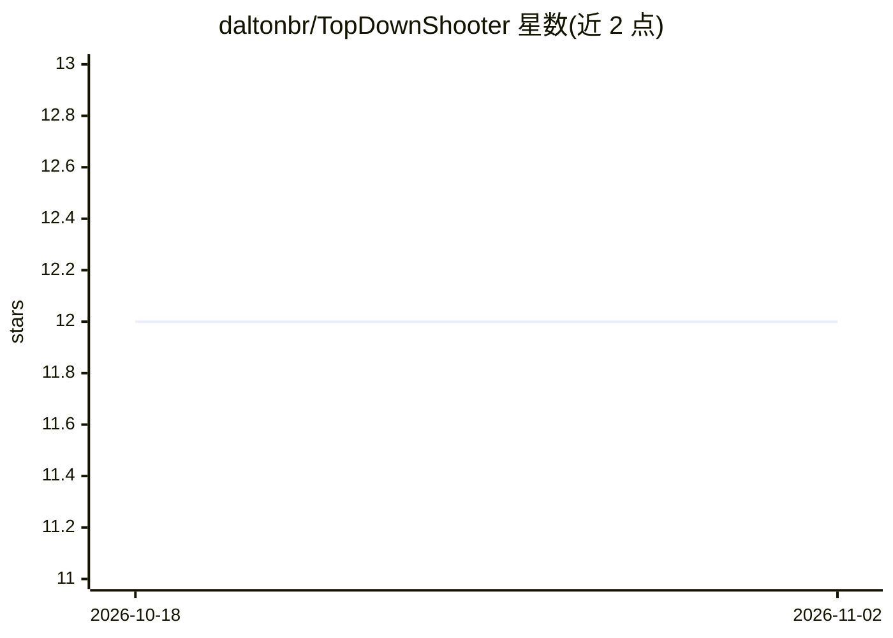

# daltonbr/TopDownShooter

⭐ 12 · C# · MIT · 推送 2026-09-19 · [GitHub](https://github.com/daltonbr/TopDownShooter) · 个人维护

**Unity 俯视射击原型，内置 Utility AI 自动操作 Bot**

一个基于 Unity 的 Top Down Shooter 原型项目，核心是在游戏中实现 Utility AI Bot 代玩家进行游戏：以打分算法在每轮刷新时计算最佳行动，扫描候选位置（网格小球表示）并按距离拾取物、敌人、弹药、生命等加权考量选出移动目标。提供调试工具以颜色分级展示各位置评分，网格大小与采样密度可调。项目从 Unity 2017 迁移至 Unity 6 与 URP，基于 Sebastian Lague 的教程开发，含 UI、拾取与装弹系统。

## 筛选速览

| 维度 | 判定 | 备注 |
|---|---|---|
| AI 角色 | `ai-enhanced` | 去掉 AI 部分产品仍成立 |
| 许可风险 | `permissive` | MIT |
| 部署形态 | `None` |  |
| 模型依赖 | — | README 未给出锁定关系 |
| 硬件要求 | — | 无带数字的原话,不猜 |
| 安装摩擦 | `low` | 无编译、无系统依赖或容器化 |
| 成熟度 | — | 结构信号不足 |

## 能力要点

- Utility AI 打分算法每轮计算最佳行动
- 扫描位置网格并按多因素加权选择移动目标
- 调试工具以颜色分级显示各位置评分，网格参数可调
- 考量项可增删调权，新增行为只需新的加权距离检查

## 适用场景

- 学习 Utility AI 在 Unity 中的实现方式
- 参考打分式 Bot 行为决策替代 FSM/行为树
- 调参观察不同权重对 Bot 行为的影响

## 场景标签

 · 领域:游戏开发/AI

## 证据(README 行号)

> L7: Inside this Top Down Shooter prototype, I implemented a Bot using the concept of *Utility AI*.
> L29: My goal in this project was to develop a Utility AI Bot to play this game.

## 星数曲线

2026-10-18 12 → 2026-11-02 12（+0）

---
*卡片 v1 · prompt 1.4 · 生成 2026-11-01 · 置信度 high · 依据 README sha `d1cc06b89c69` · [字段定义](../../DATASET.md)*
