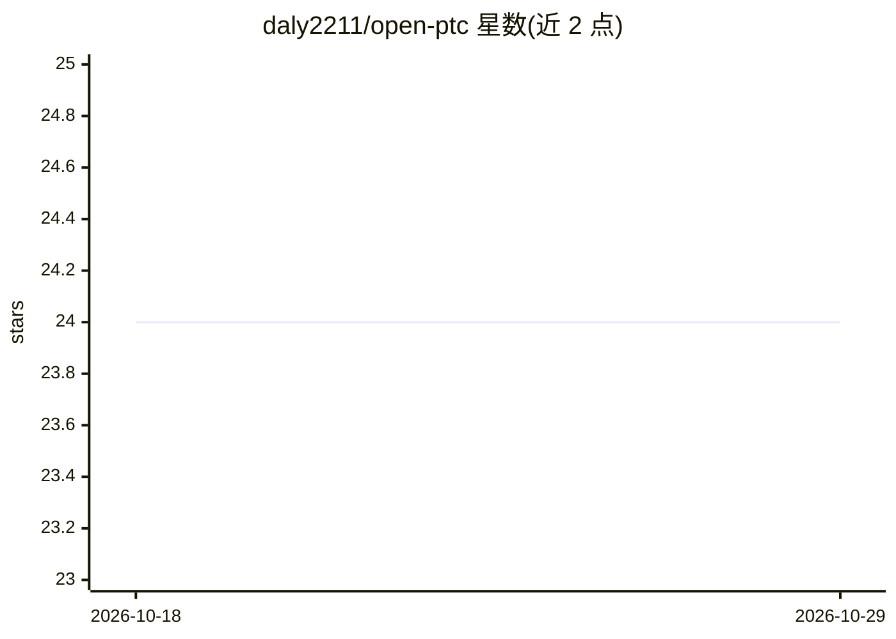

# daly2211/open-ptc

⭐ 24 · TypeScript · MIT · 推送 2026-04-25 · [GitHub](https://github.com/daly2211/open-ptc) · 个人维护

**程序化工具调用代理与沙箱运行时：让 LLM 写代码一次调用多工具**

基于 Anthropic 程序化工具调用（Programmatic Tool Calling）思路的开源代理与沙箱运行时：把多个 MCP 工具与本地函数的 schema 合并为单一 code_executor 工具，由模型生成 TypeScript 代码，在受限权限的 Deno 隔离进程中执行，从而以一次生成完成循环、分支与数据重塑等多步逻辑。同时运行 API、MCP、WebSocket、OpenAI 兼容代理四个服务；代理模式依赖 LiteLLM 做模型路由。限制：威胁模型未达多租户加固，未内置生产鉴权。

## 筛选速览

| 维度 | 判定 | 备注 |
|---|---|---|
| AI 角色 | `ai-ecosystem` | LLM/agent 周边工具 |
| 许可风险 | `permissive` | MIT |
| 部署形态 | `self-host` | docker 或自建部署 |
| 模型依赖 | — | README 未给出锁定关系 |
| 硬件要求 | — | 无带数字的原话,不猜 |
| 安装摩擦 | `low` | 无编译、无系统依赖或容器化 |
| 成熟度 | — | 结构信号不足 |

## 能力要点

- 多工具 schema 合并为单一 code_executor，减少上下文占用
- 每次执行独立 Deno 隔离沙箱，默认限网络、环境变量与超时
- 四服务架构：API/MCP/WebSocket/OpenAI 兼容代理
- 从工具 JSON Schema 自动生成 TypeScript 签名

## 适用场景

- 工具过多导致上下文膨胀的 LLM agent 应用接入运行时
- 通过标准 MCP 客户端（如 Claude Desktop）发现并执行工具
- 以 OpenAI 兼容代理模式为现有 LLM 应用注入沙箱编排
- 让沙箱回调本地 Node/Python 函数

## 场景标签

`Agent 框架` · 领域:Agent 开发

## 证据(README 行号)

> L16: It lets the model write code to call tools instead of calling them step by step. Open-PTC connects to your Model Co
> L42: - **Proxy server (9734)**: Emulates the OpenAI API, allowing you to drop Open-PTC into existing LLM apps while tran

## 星数曲线

2026-10-18 24 → 2026-10-29 24（+0）

---
*卡片 v1 · prompt 1.4 · 生成 2026-10-27 · 置信度 mid · 依据 README sha `16c4e589ed69` · [字段定义](../../DATASET.md)*
