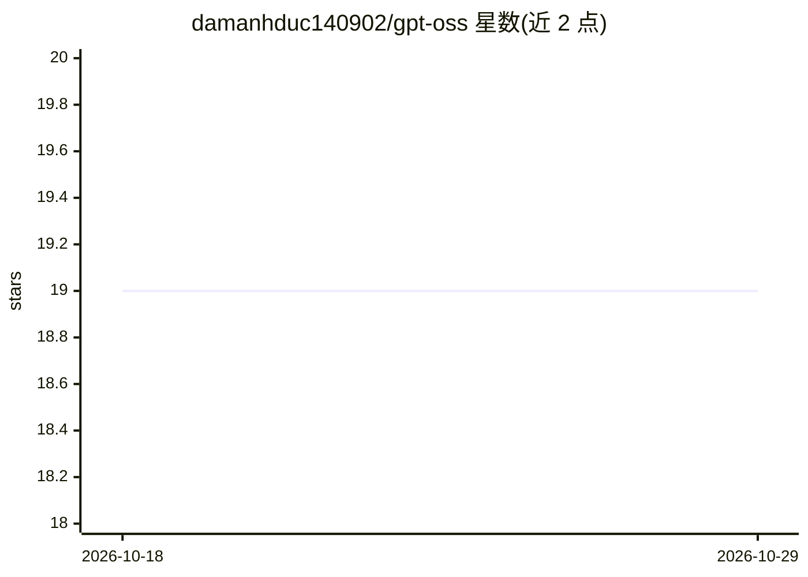

# damanhduc140902/gpt-oss

⭐ 19 · HIP · MIT · 推送 2026-09-30 · [GitHub](https://github.com/damanhduc140902/gpt-oss) · 个人维护

**纯 C++/HIP 从零实现的 gpt-oss AMD GPU 推理引擎**

针对 OpenAI gpt-oss-20b/120b 两个 MoE 模型的推理引擎，全部 GPU 内核、集合通信与分词器均在本仓库从零编写，仅依赖 HIP 运行时，不使用 rocBLAS/hipBLAS/RCCL/MPI。命令行程序（选项、采样器、chat 循环）沿用 llama2.c 的设计。在单节点 8× AMD MI250 上以批量 getp 模式测得 84,451 tok/s（20B）与 40,271 tok/s（120B），并以 METEOR/BERTScore 对比 CPU 参考实现校验输出保真度。限制：120B 配置仅支持 8 GPU；导出权重需 84/467 GB 磁盘。

## 筛选速览

| 维度 | 判定 | 备注 |
|---|---|---|
| AI 角色 | `ai-ecosystem` | LLM/agent 周边工具 |
| 许可风险 | `permissive` | MIT |
| 部署形态 | `library` | 以包/库形式分发 |
| 模型依赖 | — | README 未给出锁定关系 |
| 硬件要求 | — | 无带数字的原话,不猜 |
| 安装摩擦 | `medium` | 含编译或系统依赖之一 |
| 成熟度 | — | 结构信号不足 |

## 能力要点

- 每 kernel、collective 与 tokenizer 均从零实现，唯一依赖为 HIP 运行时
- 8× MI250 上 20B 达 84,451 tok/s、120B 达 40,271 tok/s
- 批量 getp 模式按请求数切分多 GPU 批次，含批上限与专家并行约束
- 输出经 METEOR(>0.3)/BERTScore(>0.9) 对 CPU 参考实现校验保真度

## 适用场景

- 在 AMD MI250 节点上批量推理 gpt-oss-20b/120b 并测吞吐
- 研究 HIP 手写内核（mfma、flash-attention 式优化、MoE 专家交换）
- 以 CPU 前向为参照验证优化后输出的一致性

## 场景标签

`推理引擎` · 领域:训练与推理

## 证据(README 行号)

> L13: OpenAI's `gpt-oss-20b` and `gpt-oss-120b` are already served by llama.cpp, vLLM and SGLang — all of them
> L15: both models on AMD GPUs in **plain C++ and HIP, with no external libraries at all**: no rocBLAS, no
> L21: GPUs, was written here from scratch. On a single node of 8 AMD MI250 GPUs it serves **84,451 tokens

## 星数曲线

2026-10-18 19 → 2026-10-29 19（+0）

---
*卡片 v1 · prompt 1.4 · 生成 2026-10-28 · 置信度 mid · 依据 README sha `09956ceeece0` · [字段定义](../../DATASET.md)*
