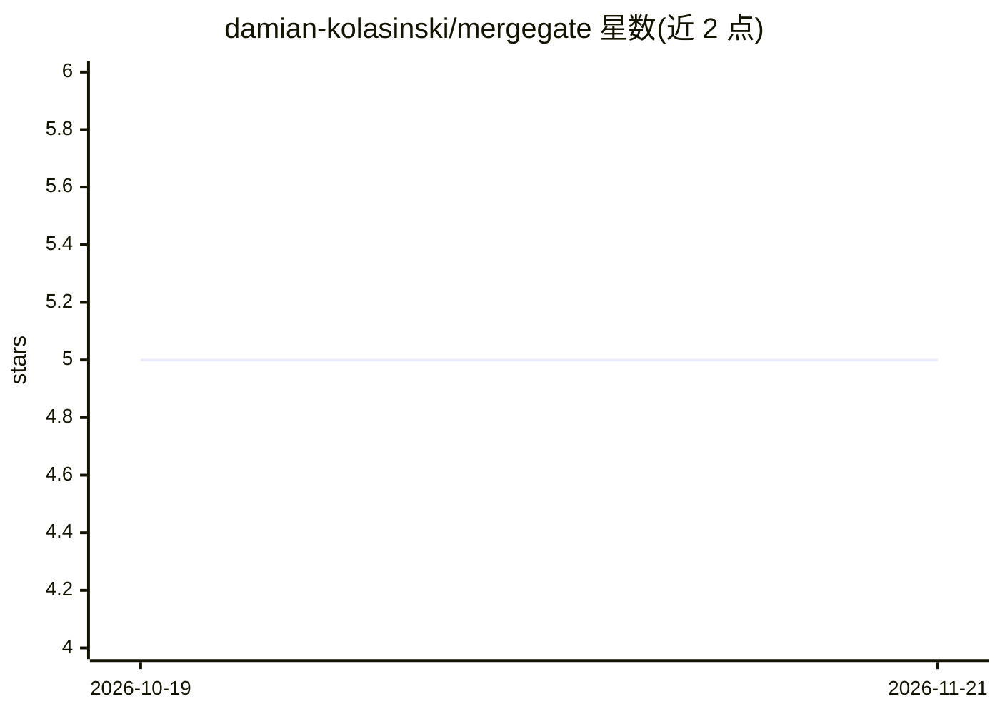

# damian-kolasinski/mergegate

⭐ 5 · Rust · MIT · 推送 2026-11-19 · [GitHub](https://github.com/damian-kolasinski/mergegate) · 个人维护

**本地代码审查中枢：汇总并回传多个 AI 编码代理的提交**

以单个 Rust 二进制运行的自托管代码审查工具，供并行运行多个 AI 编码代理的开发者使用：代理通过 mg CLI 提交分支而非手工开 PR，用户在本地收件箱按重要性排序审查文件，评论以结构化事件回传给原代理，代理修复后再提交新修订；批准即 squash 合并。支持 GitHub 与纯 git 后端，完全本地运行，无需账号、托管服务或 LLM API key。支持跨机器代理经 Tailscale 连接，提供键盘优先 UI、图像/Markdown 差异预览与冲突预检。

## 筛选速览

| 维度 | 判定 | 备注 |
|---|---|---|
| AI 角色 | `ai-ecosystem` | LLM/agent 周边工具 |
| 许可风险 | `permissive` | MIT |
| 部署形态 | `library` | 以包/库形式分发 |
| 模型依赖 | — | README 未给出锁定关系 |
| 硬件要求 | — | 无带数字的原话,不猜 |
| 安装摩擦 | `low` | 无编译、无系统依赖或容器化 |
| 成熟度 | — | 结构信号不足 |

## 能力要点

- 代理经 mg CLI 提交，评论以结构化事件回到对应代理
- 文件按重要性排序，支持可信文件折叠规则与 interdiff 复审
- 批准一键 squash 合并，hub 预检目标分支冲突
- 单一 Rust 二进制，本地运行，无需 LLM API key

## 适用场景

- 同时运行多个 AI 编码代理时集中审查它们的产出
- 在本地 git 仓库中让代理提交并接收审查反馈
- 跨多台机器的代理工作经 Tailscale 汇总到一个审查收件箱

## 场景标签

`代码审查` · 领域:编码与开发

## 证据(README 行号)

> L14: **mergegate** is an open-source, self-hosted code review hub for agentic coding. Coding agents such as Claude Code,
> L16: It runs entirely on your machine: one Rust binary, no account, no hosted service, and no LLM API key required.
> L16: It runs entirely on your machine: one Rust binary, no account, no hosted service, and no LLM API key required.

## 星数曲线

2026-10-19 5 → 2026-11-21 5（+0）

---
*卡片 v1 · prompt 1.4 · 生成 2026-11-21 · 置信度 high · 依据 README sha `bb4719d2a2b7` · [字段定义](../../DATASET.md)*
