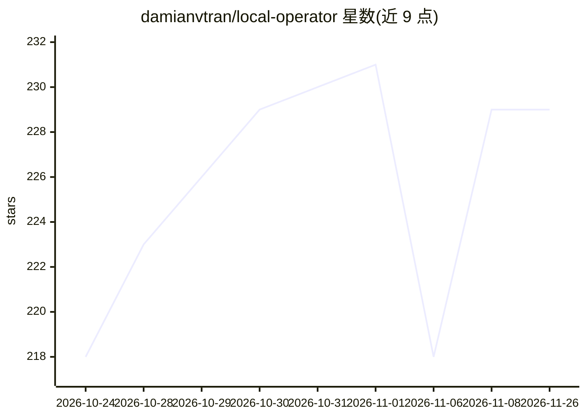

# damianvtran/local-operator

⭐ 229 · Python · MIT · 推送 2026-11-25 · [GitHub](https://github.com/damianvtran/local-operator) · [官网](https://local-operator.com) · 个人维护

**本机运行的 AI agent 协作中枢：托管、监督并连接多 agent**

Local Operator 是一个运行时/中枢，用于在用户本机托管、监督并连接 AI agent：单会话可规划工作、调用工具、浏览网页并记录历史；支持组建团队，由 manager 向受工具限制的 worker 分派任务，跨仓库会话间互发消息，并可在终端关闭后调度后续执行。写入与执行前需用户批准。接入方式包括已有订阅账号、API key 及本地推理服务器。提供桌面应用、终端 UI、手机 web 中继与浏览器扩展等形态，MIT 许可。

## 筛选速览

| 维度 | 判定 | 备注 |
|---|---|---|
| AI 角色 | `ai-ecosystem` | LLM/agent 周边工具 |
| 许可风险 | `permissive` | MIT |
| 部署形态 | `library` | 以包/库形式分发 |
| 模型依赖 | local-ok | 支持本地模型 |
| 硬件要求 | — | 无带数字的原话,不猜 |
| 安装摩擦 | `low` | 无编译、无系统依赖或容器化 |
| 成熟度 | — | 结构信号不足 |

## 能力要点

- agent 组织：subagent 并行、角色能力边界（reviewer/coder 等）与可嵌套团队
- 跨会话消息（send/hub）与多机 P2P mesh（lop network）
-  wakes 调度与后台任务，终端关闭后可恢复执行
- 订阅账号登录（ChatGPT/Claude 等）与本地服务器（Ollama/vLLM 等）接入

## 适用场景

- 在本机组建多 agent 团队分工完成编码、评审等任务
- 通过手机或浏览器远程查看和操控本机 agent 会话
- 让 agent 定时唤醒执行后续任务，长期后台运行

## 场景标签

`多智能体` `Agent 框架` · 领域:Agent 开发

## 证据(README 行号)

> L12: **Local Operator** is the runtime that hosts, supervises and connects your
> L149: `lop network` pairs your own machines into a peer-to-peer **mesh**: their

## 星数曲线

2026-10-24 218 → 2026-11-26 229（+11）

---
*卡片 v1 · prompt 1.4 · 生成 2026-11-25 · 置信度 mid · 依据 README sha `73d2731452b6` · [字段定义](../../DATASET.md)*
