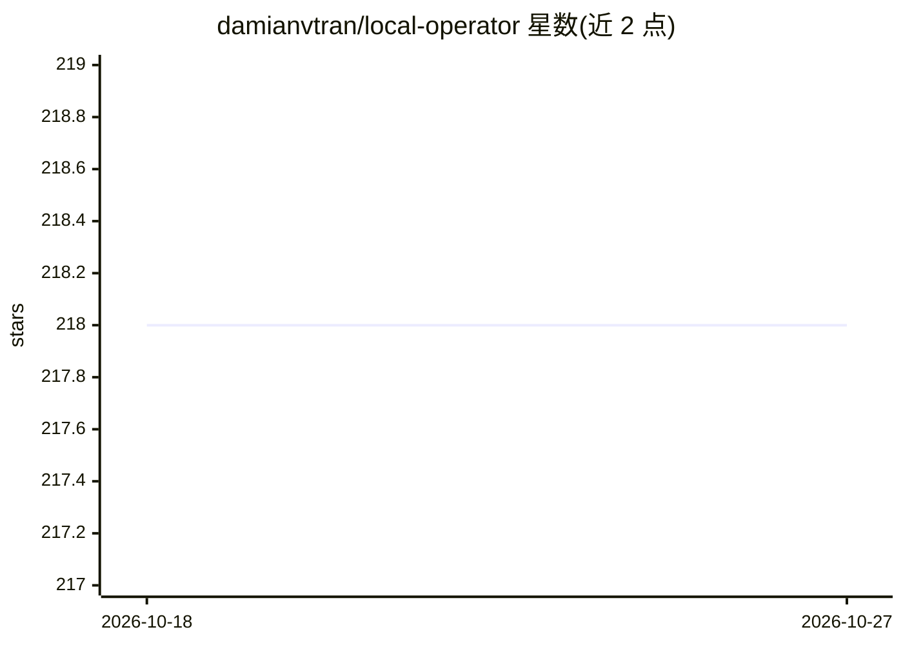

# damianvtran/local-operator

⭐ 218 · Python · MIT · 推送 2026-10-26 · [GitHub](https://github.com/damianvtran/local-operator) · [官网](https://local-operator.com) · 个人维护

**本机 AI agent 组织枢纽：多 agent 协作、后台常驻、共用现有订阅**

开源终端 AI agent 运行时（MIT），用于在本机托管、监督并连接一组协作 agent：单会话可自规划、执行工具、浏览并记忆；配置团队后由 manager 将任务委派给受角色限制的 worker，跨仓库 agent 之间可通过 send 互发消息，唤醒任务在终端关闭后仍按计划执行。账号层面汇集 ChatGPT、Claude、Kimi、Grok、Z.AI、Qwen 等已有登录并做池化与负载均衡，也支持 OpenAI/Anthropic/xAI/DeepSeek 等 API key 及 LM Studio/Ollama/vLLM/llama.cpp 本地模型。写入与 shell 命令默认需人工批准。提供一键安装脚本、uv/pipx/pip 安装与桌面应用（另行 npx 安装）。

## 筛选速览

| 维度 | 判定 | 备注 |
|---|---|---|
| AI 角色 | `ai-native` | 本体是模型或模型工具 |
| 许可风险 | `permissive` | MIT |
| 部署形态 | `self-host` | docker 或自建部署 |
| 模型依赖 | local-ok | 支持本地模型 |
| 硬件要求 | — | 无带数字的原话,不猜 |
| 安装摩擦 | `low` | 无编译、无系统依赖或容器化 |
| 成熟度 | — | 结构信号不足 |

## 能力要点

- 角色即能力边界：reviewer 等角色失去编辑工具，限制随委派继承
- 跨仓库 agent 间 send 消息与计划唤醒，终端关闭后后台任务继续
- 汇集多个 ChatGPT/Claude 等订阅账号，池化、负载均衡并针对 prompt cache 优化
- 读写默认审批门控（/approvals auto 或 --yolo 显式关闭），工具调用留可审计回执

## 适用场景

- 在本机搭建由 manager 与多个专职 worker 组成的 agent 团队协作完成任务
- 复用已有 ChatGPT/Claude 等订阅驱动多个 agent 而不另购 API
- 让 agent 在后台按计划执行长任务，并用手机远程查看和干预

## 场景标签

`多智能体` `模型网关` · 领域:Agent 开发

## 证据(README 行号)

> L13: **Local Operator** is a harness for organizations of agents: the runtime
> L20: every ChatGPT, Claude, Kimi, Grok, Z.AI, and Qwen login you already have,

## 星数曲线

2026-10-18 218 → 2026-10-27 218（+0）

---
*卡片 v1 · prompt 1.4 · 生成 2026-10-22 · 置信度 mid · 依据 README sha `2fcb396f0fc1` · [字段定义](../../DATASET.md)*
