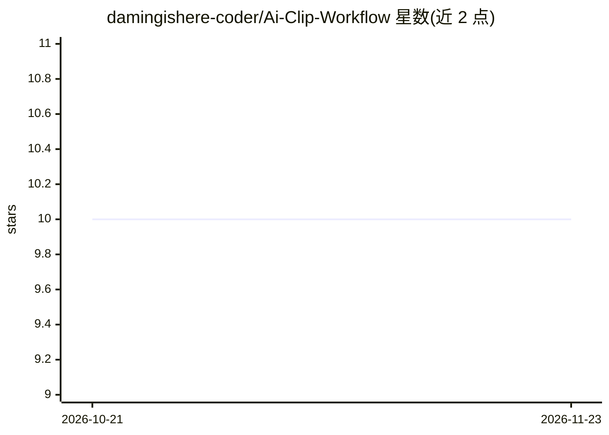

# damingishere-coder/Ai-Clip-Workflow

⭐ 10 · Python · MIT · 推送 2026-11-12 · [GitHub](https://github.com/damingishere-coder/Ai-Clip-Workflow) · 个人维护 · 中文 README

**给内容创作者的本地 AI 长视频切片工作台**

在本地 Windows 电脑上运行的视频短片生产工作台：导入长视频后由本地 faster-whisper 完成转写，AI 对候选片段做结构化评分找高光，经人工审片确认后用 FFmpeg 切片并生成字幕，再进行标题、封面等内容准备与排期，支持导入抖音作品指标做复盘。AI Provider 可配置为 Codex CLI、OpenAI-compatible/DeepSeek 或 Ollama 兼容入口；本地优先，视频与数据库保存在本机。面向本地单用户，不支持云端多人协作，正式发布需 Chrome Worker 逐账号登录。

## 筛选速览

| 维度 | 判定 | 备注 |
|---|---|---|
| AI 角色 | `ai-native` | 本体是模型或模型工具 |
| 许可风险 | `permissive` | MIT |
| 部署形态 | `desktop` | 安装包/桌面程序 |
| 模型依赖 | local-ok | 支持本地模型 |
| 硬件要求 | — | 无带数字的原话,不猜 |
| 安装摩擦 | `medium` | 含编译或系统依赖之一 |
| 成熟度 | — | 结构信号不足 |

## 能力要点

- 本地 faster-whisper 转写与 AI 高光候选结构化评分
- 可选视觉辅助：抽取关键帧参与综合评审（试用）
- 五种内容模板与复盘报告、周总结、动态排期
- 抖音发布经 Windows Chrome Worker 执行，B站保留后端但前台未启用

## 适用场景

- 把播客/访谈/长直播切成语种短片并准备发布素材
- 人工审片确认 AI 高光候选后再切片成片
- 导入抖音指标做周总结与 Prompt 版本对比复盘

## 场景标签

`语音识别` `图像视频处理` `浏览器自动化` · 领域:效率与自动化

## 证据(README 行号)

> L7: 在自己的 Windows 电脑上，完成转写、AI 找高光、人工审片、切片、内容准备与排期。
> L44: **本地优先，处理方式由你配置。** 视频、数据库与浏览器登录状态保存在本机；选择远程转写或 AI 服务时，相应音频或文本会发送给所选服务。转写支持本地模式；AI 支持受控 Codex CLI，并保留 OpenAI-compati

## 星数曲线

2026-10-21 10 → 2026-11-23 10（+0）

---
*卡片 v1 · prompt 1.4 · 生成 2026-11-19 · 置信度 high · 依据 README sha `85fbf52009e4` · [字段定义](../../DATASET.md)*
