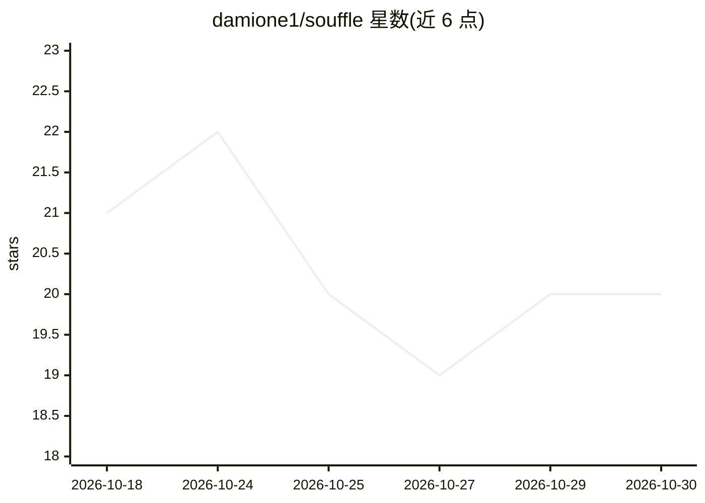

# damione1/souffle

⭐ 20 · Rust · GPL-3.0 · 推送 2026-10-21 · [GitHub](https://github.com/damione1/souffle) · [官网](usesouffle.app) · 个人维护

**macOS 全本地会议转录与听写应用，录音不离开本机**

面向 macOS Apple Silicon 用户的隐私优先语音转文字桌面应用：本地运行 Kyutai/Whisper/Parakeet 模型，提供实时会议转录（区分我与对方）、任意应用内听写（快捷键唤起悬浮胶囊、本地 LLM 润色后粘贴回原输入框）、设备端摘要（Apple Intelligence 或本地 Ollama 生成决定与行动项）。数据存于本地 SQLite，可导出 Markdown/JSON/SRT/VTT，附带只读 MCP server 供 Claude 等 MCP 客户端检索转录，另有 headless CLI。限制：仅 Apple Silicon、无 Intel 构建；会议捕获对方声音需 macOS 14.4+。经 Homebrew cask 或 .dmg 安装。

## 筛选速览

| 维度 | 判定 | 备注 |
|---|---|---|
| AI 角色 | `ai-native` | 本体是模型或模型工具 |
| 许可风险 | `viral` | GPL-3.0 |
| 部署形态 | `desktop` | 安装包/桌面程序 |
| 模型依赖 | local-ok | 支持本地模型 |
| 硬件要求 | — | 无带数字的原话,不猜 |
| 安装摩擦 | `medium` | 含编译或系统依赖之一 |
| 成熟度 | — | 结构信号不足 |

## 能力要点

- 4 种本地 STT 模型可选，全部设备端运行、可离线使用
- 系统音频分离 Me/Them 会议双通道，无需虚拟音频设备
- 本地 LLM 润色听写文本与生成含行动项的会议摘要
- 内置 souffle-mcp 只读 MCP server 与 headless CLI

## 适用场景

- 在 Mac 上离线转录会议并生成决定与行动项摘要
- 用快捷键在任意应用（邮件/编辑器/终端）内听写输入
- 通过 MCP 让 Claude Desktop 检索我的历史转录

## 场景标签

`语音识别` · 领域:感知与多模态

## 证据(README 行号)

> L5:  Private speech-to-text for macOS that never leaves your Mac.
> L33: - **A summary when you want one**, written on-device by Apple Intelligence on macOS 26 or newer, or by a local Olla
> L87: - Kyutai STT 1B (default): French + English, ~2.4 GB, Metal GPU via Candle. Streams text while you speak.

## 星数曲线

2026-10-18 21 → 2026-10-30 20（-1）

---
*卡片 v1 · prompt 1.4 · 生成 2026-10-28 · 置信度 high · 依据 README sha `6416bc47c0ed` · [字段定义](../../DATASET.md)*
