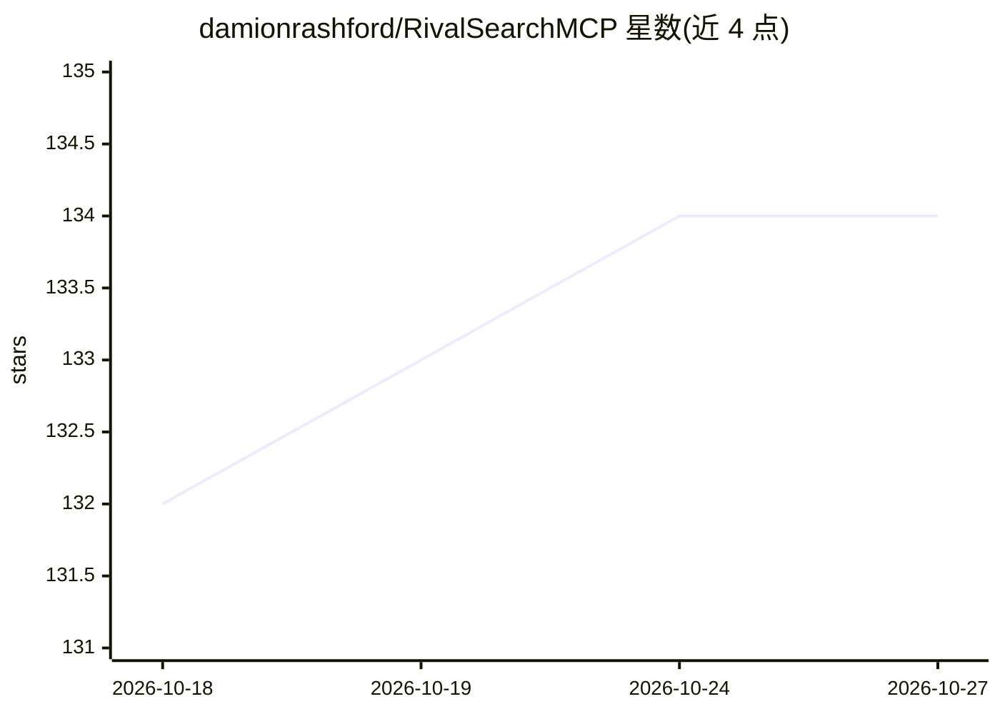

# damionrashford/RivalSearchMCP

⭐ 134 · Python · MIT · 推送 2026-10-26 · [GitHub](https://github.com/damionrashford/RivalSearchMCP) · 个人维护

**给 AI agent 用的确定性研究 MCP 服务器：聚合网络/社交/学术/新闻检索**

基于 FastMCP 3.x 的远程/本地 MCP 服务器，向 AI 助手（Cursor、Claude Desktop/Code、VS Code、Codex）暴露 9 个研究工具：5 引擎网页搜索、9 平台社交搜索、5 源新闻聚合、GitHub 检索、网站遍历、内容分析与冲突检测、实体画像、文档提取（含 EasyOCR）、学术论文与数据集检索。服务器内不运行 LLM，工具返回确定性的结构化输出供调用方模型整合；核心工具无需 API key，托管版有公平使用限速，可自行本地部署。

## 筛选速览

| 维度 | 判定 | 备注 |
|---|---|---|
| AI 角色 | `ai-ecosystem` | LLM/agent 周边工具 |
| 许可风险 | `permissive` | MIT |
| 部署形态 | `None` |  |
| 模型依赖 | locked-api |  |
| 硬件要求 | — | 无带数字的原话,不猜 |
| 安装摩擦 | `low` | 无编译、无系统依赖或容器化 |
| 成熟度 | — | 结构信号不足 |

## 能力要点

- 9 个工具覆盖网页/社交/新闻/GitHub/学术/文档检索与分析
- 服务器内无 LLM，输出确定性且带 structuredContent 供 agent 链式调用
- 来源质量自动评分（0-100）与跨来源冲突检测（数值/日期/立场）
- 核心工具零 API key，提供托管服务器、本地安装、Claude Code/Codex 插件与独立 CLI skill 多种接入方式

## 适用场景

- 让我的 AI 助手一站式检索网页、社交、新闻与学术来源
- 对比多个来源并自动发现相互冲突的数据或结论
- 对给定 URL 做来源质量评分与实体画像调研

## 场景标签

`科研工具` `网页抓取` · 领域:效率与自动化

## 证据(README 行号)

> L21: RivalSearchMCP is a FastMCP 3.x server exposing **9 specialized tools** that search, fetch, score, and compare info
> L31: **No LLM runs inside the server.** Every tool returns deterministic, auditable output — the caller's model does the
> L35: - **One connection, nine tools** — no need to wire up separate MCP servers per source

## 星数曲线

2026-10-18 132 → 2026-10-27 134（+2）

---
*卡片 v1 · prompt 1.4 · 生成 2026-10-22 · 置信度 high · 依据 README sha `29c9f1f513ca` · [字段定义](../../DATASET.md)*
