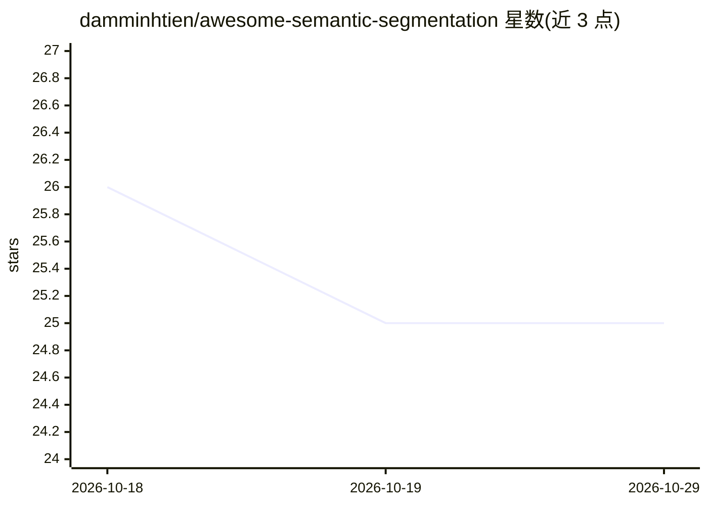

# damminhtien/awesome-semantic-segmentation

⭐ 25 · Apache-2.0 · 推送 2026-04-10 · [GitHub](https://github.com/damminhtien/awesome-semantic-segmentation) · 个人维护

**语义分割论文与模型策展清单：按时代梳理入门到前沿**

语义分割领域的资源策展清单：定义任务并列举其在自动驾驶、医学影像、遥感等领域的应用；按 FCN→U-Net→DeepLab→SegFormer→Mask2Former→SAM 的演进脉络组织里程碑论文，配 S/A/B 优先级标注、推荐阅读顺序表、时代时间线及代表性方法表（含论文与代码链接）。面向该领域的学习者与研究者，覆盖 2014 至 2026 年方向（含开放词汇、可提示基础分割）。清单本身无需安装，纯阅读资源。

## 筛选速览

| 维度 | 判定 | 备注 |
|---|---|---|
| AI 角色 | `ai-knowledge` | 知识聚合/清单类 |
| 许可风险 | `permissive` | Apache-2.0 |
| 部署形态 | `None` |  |
| 模型依赖 | — | README 未给出锁定关系 |
| 硬件要求 | — | 无带数字的原话,不猜 |
| 安装摩擦 | `low` | 无编译、无系统依赖或容器化 |
| 成熟度 | — | 结构信号不足 |

## 能力要点

- 按时代组织的突破时间线（FCN 到 SAM 3，2014-2026）
- S/A/B 三级优先级与推荐阅读顺序表
- 代表性方法表含论文与代码/项目链接
- 覆盖开放词汇、可提示分割、视频分割等前沿方向

## 适用场景

- 按推荐顺序系统学习语义分割领域
- 查找代表性方法的论文与代码入口
- 了解 2021-2026 年分割领域的趋势（通用分割、基础模型）

## 场景标签

`精选清单` · 领域:学习与行业

## 证据(README 行号)

> L4: > ## A curated list of useful resources around semantic segmentation :tada:
> L7: Semantic segmentation is a **computer vision task in which every pixel is assigned a semantic label**. It answers th

## 星数曲线

2026-10-18 26 → 2026-10-29 25（-1）

---
*卡片 v1 · prompt 1.4 · 生成 2026-10-27 · 置信度 high · 依据 README sha `928f76c69cfb` · [字段定义](../../DATASET.md)*
