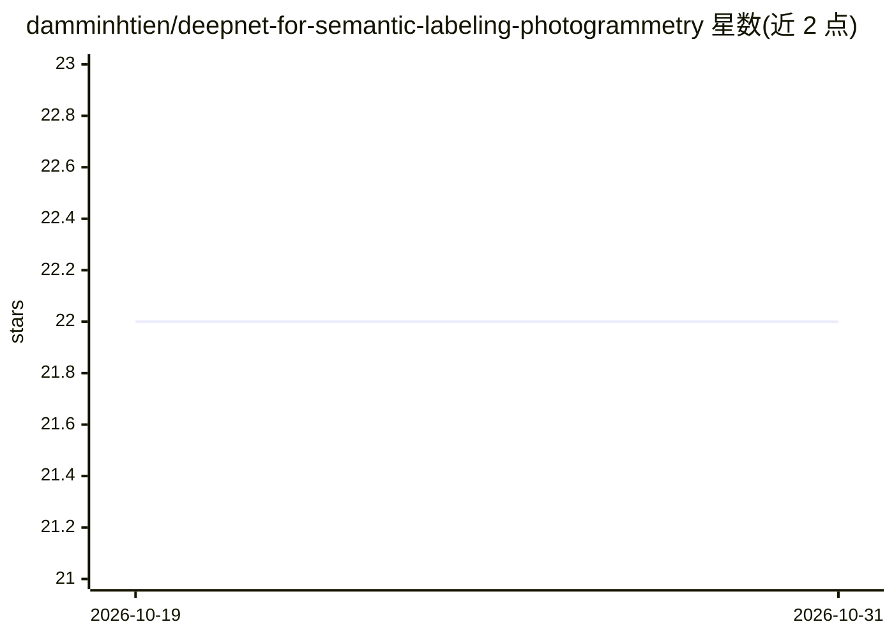

# damminhtien/deepnet-for-semantic-labeling-photogrammetry

⭐ 22 · Jupyter Notebook · 推送 2026-10-28 · [GitHub](https://github.com/damminhtien/deepnet-for-semantic-labeling-photogrammetry) · 个人维护

**高分辨率遥感影像语义分割的数据与模型组件管线**

面向 ISPRS Potsdam/Vaihingen 数据集的高分辨率地理空间语义分割项目：提供版本化数据契约（场景目录、切分清单、预处理规范、模型输入规范）、DVC 数据版本管理与可组合模型组件（光谱适配器、可替换编码器、分割头）。同一管线可在本地 Mac、Kaggle GPU 或服务器上运行，运行时按可用性选择 MPS/CUDA/CPU。包含 DINOv3 联合训练计划，但 README 声明尚无完整的训练/评测 runner，需调用方实现；历史实验报告需重跑后才可视为当前结果。

## 筛选速览

| 维度 | 判定 | 备注 |
|---|---|---|
| AI 角色 | `ai-native` | 本体是模型或模型工具 |
| 许可风险 | `none` | — |
| 部署形态 | `library` | 以包/库形式分发 |
| 模型依赖 | — | README 未给出锁定关系 |
| 硬件要求 | — | 无带数字的原话,不猜 |
| 安装摩擦 | `medium` | 含编译或系统依赖之一 |
| 成熟度 | `idea` | |

## 能力要点

- 版本化数据契约：目录、切分清单、预处理规范、模型输入规范与 bundle 格式
- DVC 管理不可变源数据，训练/验证 bundle 严格排除测试标签
- 可组合模型组件：光谱适配器、可替换编码器与分割头
- 跨本地 Mac、Kaggle GPU 与服务器运行，运行时自动选择 MPS/CUDA/CPU

## 适用场景

- 在 Potsdam/Vaihingen 上构建可复现的语义分割训练与评测流程
- 管理遥感数据集的版本、切分与数据质量审计
- 在 Kaggle 上执行锁定的训练与一次性测试评估协议

## 场景标签

`目标检测` · 领域:感知与多模态

## 证据(README 行号)

> L3: DeepNet provides reusable data contracts and configurable model components for
> L35: The catalog descriptors cover ISPRS Potsdam and Vaihingen. Source imagery and labels
> L99: `configs/training/isprs-dinov3-joint-v2.json` describes one balanced IRRG run across

## 星数曲线

2026-10-19 22 → 2026-10-31 22（+0）

---
*卡片 v1 · prompt 1.4 · 生成 2026-10-27 · 置信度 high · 依据 README sha `df4bda305820` · [字段定义](../../DATASET.md)*
