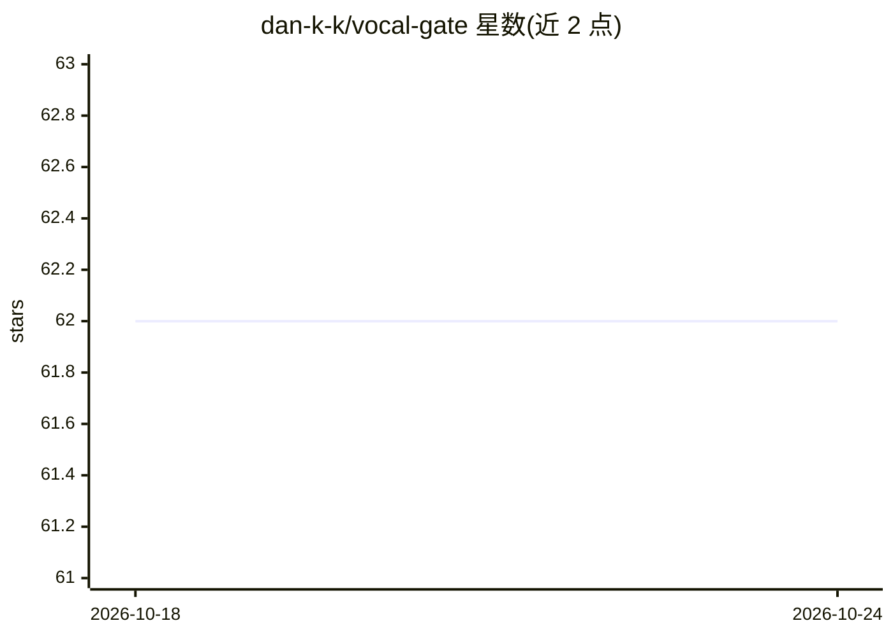

# dan-k-k/vocal-gate

⭐ 62 · C++ · GPL-3.0 · 推送 2026-04-05 · [GitHub](https://github.com/dan-k-k/vocal-gate) · 个人维护

**面向创作者的 AI 噪声门 VST3/AU 插件，实时去除咳嗽喷嚏**

免费音频插件，提供 VST3 与 AU 两种格式，用训练好的 AI 模型将干净人声与麦克风杂音（咳嗽、喷嚏、键盘声、呼吸声）分离，适用于直播、播客录制与视频剪辑。模型经剪枝与 int8 量化为 ONNX 格式，每 buffer 推理约 0.3ms 以实现实时处理；直播场景需 750ms lookahead，需手动延迟画面与桌面音频保持同步。提供 macOS/Windows/Linux 安装包，安装包未签名；兼容 OBS、达芬奇、Premiere 等宿主软件。

## 筛选速览

| 维度 | 判定 | 备注 |
|---|---|---|
| AI 角色 | `ai-enhanced` | 去掉 AI 部分产品仍成立 |
| 许可风险 | `viral` | GPL-3.0 |
| 部署形态 | `desktop` | 安装包/桌面程序 |
| 模型依赖 | — | README 未给出锁定关系 |
| 硬件要求 | — | 无带数字的原话,不猜 |
| 安装摩擦 | `low` | 无编译、无系统依赖或容器化 |
| 成熟度 | — | 结构信号不足 |

## 能力要点

- 剪枝与 int8 量化的 ONNX 模型，每 buffer 推理约 0.3ms
- 提供 VST3/AU 双格式，支持 macOS/Windows/Linux 安装包
- 适用于 OBS、DaVinci Resolve、Premiere、Reaper 等宿主软件
- 直播使用时需 750ms lookahead 并手动同步其他源

## 适用场景

- 直播时把咳嗽和喷嚏压掉，避免出声
- 播客或视频后期中移除呼吸声与键盘杂音
- 录音时过滤不需要的麦克风杂音

## 场景标签

 · 领域:音频处理/内容创作工具

## 证据(README 行号)

> L3: Vocal Gate is a free AI noise gate VST3/AU plugin trained to separate clean speech from unwanted microphone artifact
> L50:  AI_Inference

## 星数曲线

2026-10-18 62 → 2026-10-24 62（+0）

---
*卡片 v1 · prompt 1.4 · 生成 2026-10-24 · 置信度 high · 依据 README sha `993d9e8bb54f` · [字段定义](../../DATASET.md)*
