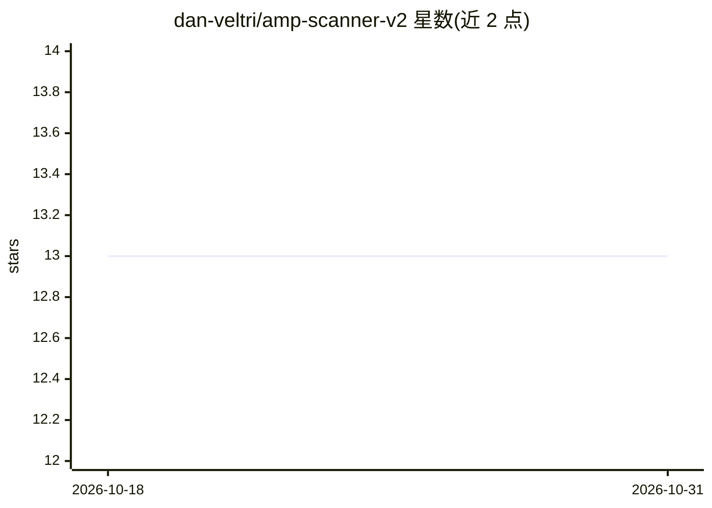

# dan-veltri/amp-scanner-v2

⭐ 13 · Python · GPL-3.0 · 推送 2026-09-26 · [GitHub](https://github.com/dan-veltri/amp-scanner-v2) · [官网](https://www.ampscanner.com) · 个人维护

**抗菌肽识别工具：深度学习预测蛋白序列是否为 AMP**

AMP Scanner v2 是 2018 年 Bioinformatics 论文 'Deep learning improves antimicrobial peptide recognition' 的 GPLv3 开源代码，用 TensorFlow 1.x/Keras 深度学习模型对 FASTA 格式蛋白序列做抗菌肽（AMP）二分类预测。提供预训练模型（.h5）直接预测，输出 AMP 候选 FASTA 文件与逐序列概率 CSV；也可用自有 AMP/Decoy 数据训练新模型。输入要求序列 ≥10 且建议 ≤200 氨基酸，限指定氨基酸字符集。限制：绑定 Python 3.6 与 TensorFlow 1.x 旧版本环境，作者不提供安装支持。

## 筛选速览

| 维度 | 判定 | 备注 |
|---|---|---|
| AI 角色 | `ai-native` | 本体是模型或模型工具 |
| 许可风险 | `viral` | GPL-3.0 |
| 部署形态 | `self-host` | docker 或自建部署 |
| 模型依赖 | — | README 未给出锁定关系 |
| 硬件要求 | — | 无带数字的原话,不猜 |
| 安装摩擦 | `low` | 无编译、无系统依赖或容器化 |
| 成熟度 | — | 结构信号不足 |

## 能力要点

- 预训练 .h5 模型对 FASTA 序列做 AMP 概率预测，输出候选 FASTA 与 CSV
- 支持用自有 AMP/Decoy 数据集训练新模型，含可复现种子与确定性模式
- 可自定义概率阈值与最大序列长度
- GPLv3 开源，附原始论文数据集与测试套件

## 适用场景

- 我有一批蛋白序列，想筛出潜在的抗菌肽候选
- 我想用自己的正负样本训练 AMP 分类模型
- 我想复现论文模型在自己测试集上的表现

## 场景标签

 · 领域:生物信息学/蛋白质分类

## 证据(README 行号)

> L3: Antimicrobial Peptide Scanner Version 2. Open source GLPv3 release of code from 2018 paper "Deep learning improves
> L130: The `amp_scanner_v2_predict_tf1.py` script is used to run predictions on your own query FASTA file using a pre-tra

## 星数曲线

2026-10-18 13 → 2026-10-31 13（+0）

---
*卡片 v1 · prompt 1.4 · 生成 2026-10-31 · 置信度 mid · 依据 README sha `488e8185536f` · [字段定义](../../DATASET.md)*
