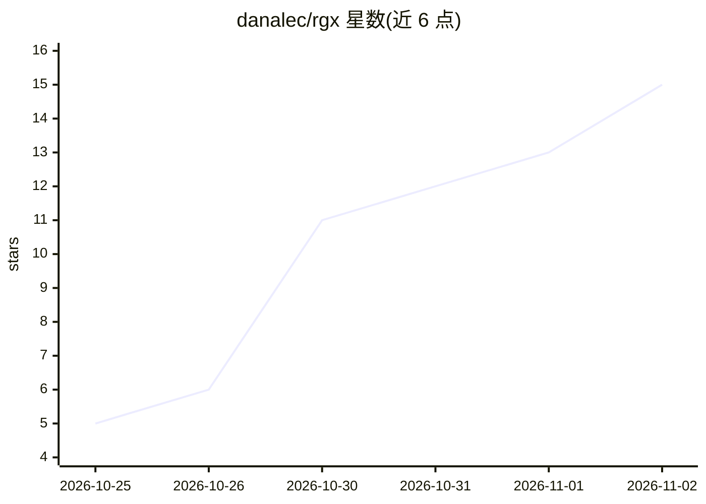

# danalec/rgx

⭐ 15 · Rust · NOASSERTION · 推送 2026-10-28 · [GitHub](https://github.com/danalec/rgx) · 个人维护

**能读进文件内部全文检索的 ripgrep 兼容搜索 CLI**

Rust 编写的命令行搜索工具，兼容 ripgrep 的参数、path:line:text 输出与退出码，可深入 PDF、Office 文档、压缩包、邮件、媒体元数据及 GGUF/safetensors 等 LLM 模型文件内部检索，所有适配器在进程内运行、零外部依赖。支持基于文件事实的 --filter 查询语法与 JSONL 事实索引，并可经 --mcp 以 MCP 服务器形式向 AI 客户端暴露 search 与 facts 两个工具。面向开发者，通过 cargo、安装脚本、各平台包管理器分发。

## 筛选速览

| 维度 | 判定 | 备注 |
|---|---|---|
| AI 角色 | `ai-enhanced` | 去掉 AI 部分产品仍成立 |
| 许可风险 | `none` | NOASSERTION |
| 部署形态 | `desktop` | 安装包/桌面程序 |
| 模型依赖 | — | README 未给出锁定关系 |
| 硬件要求 | — | 无带数字的原话,不猜 |
| 安装摩擦 | `medium` | 含编译或系统依赖之一 |
| 成熟度 | — | 结构信号不足 |

## 能力要点

- ripgrep 兼容的参数、输出与退出码，可直接替换进现有管线
- 十八族格式的进程内解析适配器，零外部依赖
- --filter 事实查询语法与 JSONL 事实索引（rg/jq 可读）
- --mcp 提供 MCP 服务器（search/facts 两工具）

## 适用场景

- 在 PDF、Office 文档和压缩包内直接 grep 文本
- 检查 GGUF/safetensors 模型文件内的张量名与元数据
- 作为 MCP 工具接入 AI agent 做本地文件检索

## 场景标签

 · 领域:开发者工具/全文检索

## 证据(README 行号)

> L3: `rg` that reads **inside** files — PDFs, Office documents, archives, 3D models,
> L256: `--mcp` puts rgx behind a **Model Context Protocol** server: JSON-RPC 2.0

## 星数曲线

2026-10-25 5 → 2026-11-02 15（+10）

---
*卡片 v1 · prompt 1.4 · 生成 2026-10-31 · 置信度 high · 依据 README sha `66ed944ee0c6` · [字段定义](../../DATASET.md)*
