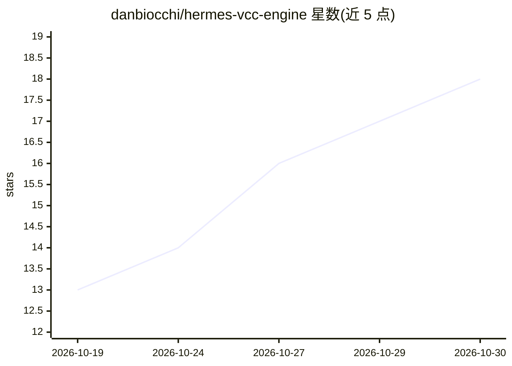

# danbiocchi/hermes-vcc-engine

⭐ 18 · Python · Apache-2.0 · 推送 2026-10-26 · [GitHub](https://github.com/danbiocchi/hermes-vcc-engine) · [官网](https://hermes-agent.nousresearch.com/docs/plugins/hermes-vcc-engine) · 个人维护

**Hermes Agent 的即时上下文压缩插件，无 LLM 调用生成压缩摘要**

面向 Hermes Agent（0.21.7+）的上下文压缩引擎插件。当对话填满上下文窗口时，以固定规则从中间消息抽取目标、错误与修复、文件、命令及退出码等信息生成摘要，耗时约 0.05 秒且不做任何模型调用；摘要每行带 [#N] 链接回原始消息，原始消息仍归档于会话库可经 session_search 打开。通过 hermes plugins install 安装并切换 context.engine 为 vcc；支持仅本地模型启用、预算比例等配置，出错可回退到原生 LLM 摘要。README 声明基于 VCC 论文并给出基准数据（含局限说明：测试来自单一用户与单一模型）。

## 筛选速览

| 维度 | 判定 | 备注 |
|---|---|---|
| AI 角色 | `ai-ecosystem` | LLM/agent 周边工具 |
| 许可风险 | `permissive` | Apache-2.0 |
| 部署形态 | `library` | 以包/库形式分发 |
| 模型依赖 | — | README 未给出锁定关系 |
| 硬件要求 | — | 无带数字的原话,不猜 |
| 安装摩擦 | `low` | 无编译、无系统依赖或容器化 |
| 成熟度 | — | 结构信号不足 |

## 能力要点

- 压缩摘要约 0.05 秒生成，无 LLM 调用（每压缩 0 次）
- 摘要保留命令、退出码、错误与文件，每行带 [#N] 链接回原始消息
- 原消息归档于会话库，可用 session_search 打开完整内容
- 支持 only_local_models / 预算配置，出错可回退原生 LLM 摘要

## 适用场景

- 在本地或慢速模型上运行 Hermes 时消除分钟级的压缩等待
- 长编码/运维会话反复压缩后仍需保留命令与错误的准确细节
- 需要确定性摘要（同一输入同一输出）的场景

## 场景标签

`Agent 记忆` · 领域:Agent 开发

## 证据(README 行号)

> L11: When a Hermes Agent conversation fills its context window, Hermes stops and asks your model to write a summary of e
> L20: hermes plugins install danbiocchi/hermes-vcc-engine --enable
> L53: Hermes compacts by keeping the start and the most recent part of the conversation and replacing the middle with a s

## 星数曲线

2026-10-19 13 → 2026-10-30 18（+5）

---
*卡片 v1 · prompt 1.4 · 生成 2026-10-29 · 置信度 mid · 依据 README sha `4d7828d1e679` · [字段定义](../../DATASET.md)*
