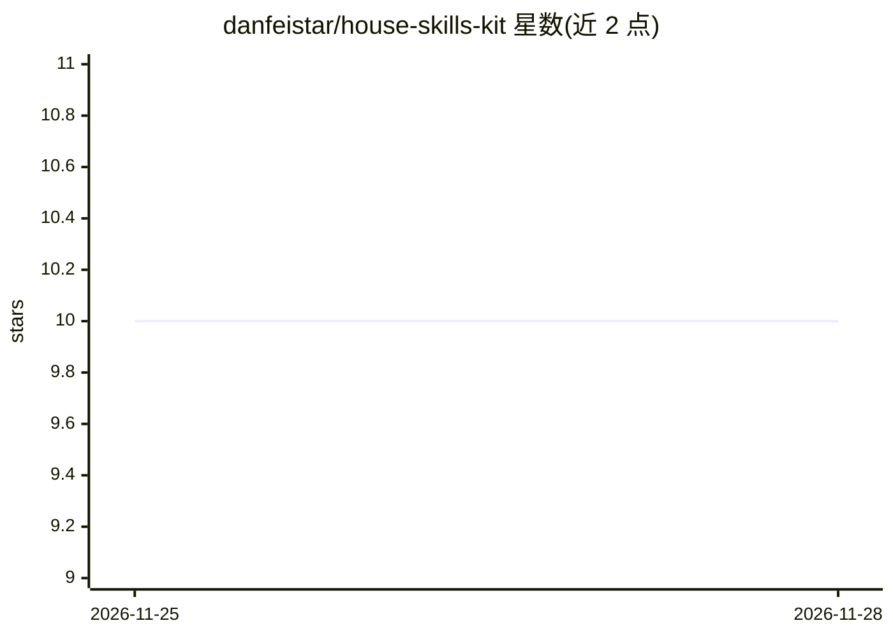

# danfeistar/house-skills-kit

⭐ 10 · Python · Apache-2.0 · 推送 2026-11-27 · [GitHub](https://github.com/danfeistar/house-skills-kit) · [官网](https://clawhub.ai/skills/house-skills-kit) · 个人维护 · 中文 README

**中文房地产行业的 AI 技能库：7 类角色 30 个技能**

面向房地产行业七类角色（开发商、经纪公司、渠道分销、购房者/业主、一手销售、二手经纪、自媒体博主）的 AI 技能集合，skills/ 目录下各技能含 SKILL.md 提示词与配套工具，可独立安装发布。配套 calc-toolkit 计算工具包（19 件 Python 命令行工具）与 35 城政策规则库（四层规则引擎，参数来源可追溯）。纯 Python 标准库零外部依赖，Python 3.8+ 直接运行；技能可装进 Claude 等 Agent 使用。

## 筛选速览

| 维度 | 判定 | 备注 |
|---|---|---|
| AI 角色 | `ai-knowledge` | 知识聚合/清单类 |
| 许可风险 | `permissive` | Apache-2.0 |
| 部署形态 | `None` |  |
| 模型依赖 | — | README 未给出锁定关系 |
| 硬件要求 | — | 无带数字的原话,不猜 |
| 安装摩擦 | `low` | 无编译、无系统依赖或容器化 |
| 成熟度 | `idea` | |

## 能力要点

- 7 类房产角色 × 30 个独立技能，各含完整提示词
- calc-toolkit：房贷/税费/佣金/回报率等 19 件命令行测算工具
- 35 城规则库 + 四层规则引擎，政策数据与代码分离（cities.yaml）
- template 品牌骨架：4 类角色原型 × 31 业务模块，配置即可生成专属技能

## 适用场景

- 二手经纪人按 SOP 做房源开发、客户匹配与交易流程
- 购房者自查首套认定、可贷上限与税费成本
- 开发商营销负责人做项目研判、定价与渠道管理
- 为自家门店生成品牌专属的顾问技能

## 场景标签

`提示工程` · 领域:Agent 开发

## 证据(README 行号)

> L11: **房产 AI 技能仓库 —— 按身份分 Skill，按需取用。**
> L13: 为房地产行业的七类角色提供开箱即用的 AI 技能（Skill）：房开企业、经纪公司、渠道分销公司、购房者/业主、二手经纪人、一手销售人员、房产自媒体博主。每个身份场景对应一个独立 Skill，`skills/` 目录下各技能均含完
> L153: skills/            # 25 个独立技能，每个自带 SKILL.md（+ README.md / 正文 / 可选工具）

## 星数曲线

2026-11-25 10 → 2026-11-28 10（+0）

---
*卡片 v1 · prompt 1.4 · 生成 2026-11-24 · 置信度 high · 依据 README sha `6d598e255f7f` · [字段定义](../../DATASET.md)*
