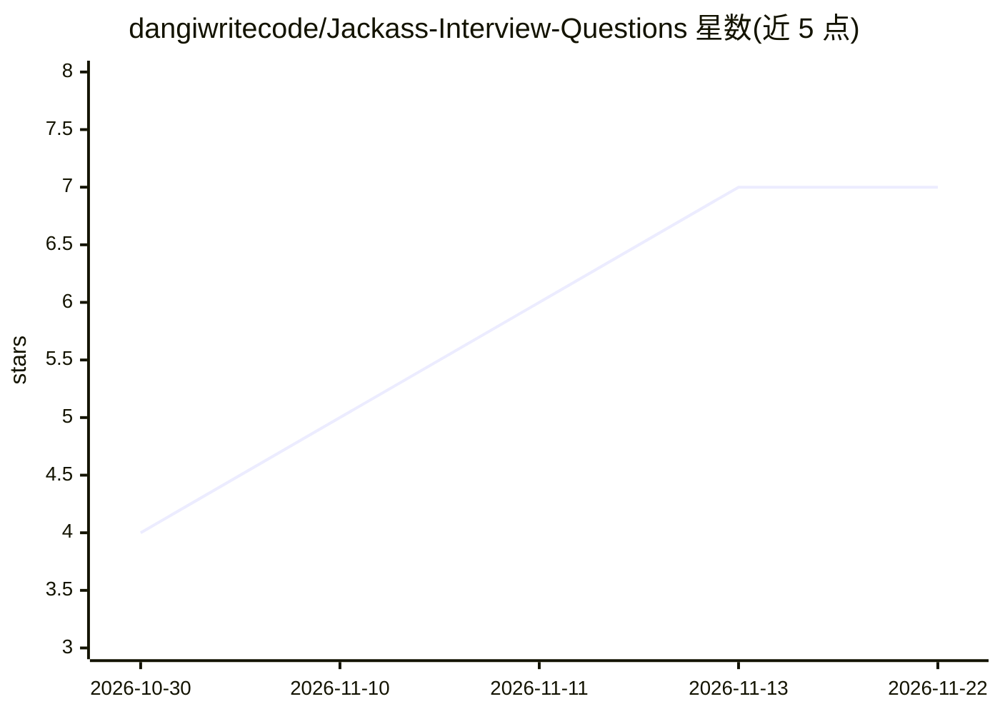

# dangiwritecode/Jackass-Interview-Questions

⭐ 7 · 推送 2026-10-28 · [GitHub](https://github.com/dangiwritecode/Jackass-Interview-Questions) · 个人维护

**面向求职者的公司面试题库清单（2,246 家公司）**

以公司字母索引组织的面试题库仓库：收录 2,246 家公司、130,998 道题库题目，README 按 Popular 与 A-Z 分节列出每家公司的 Tier 分级、收录题数与直接打标数，内容覆盖 Amazon、Google、Anthropic、OpenAI 等科技公司与咨询、金融、印度外包企业。提供跳转导航，提示用户登录一次后进入对应公司的题目页面备考。

## 筛选速览

| 维度 | 判定 | 备注 |
|---|---|---|
| AI 角色 | `ai-knowledge` | 知识聚合/清单类 |
| 许可风险 | `none` | — |
| 部署形态 | `None` |  |
| 模型依赖 | — | README 未给出锁定关系 |
| 硬件要求 | — | 无带数字的原话,不猜 |
| 安装摩擦 | `low` | 无编译、无系统依赖或容器化 |
| 成熟度 | — | 结构信号不足 |

## 能力要点

- 2,246 家公司、130,998 道题库题目的索引
- 每家公司标注 Tier 分级、收录题数与直接打标数
- 按 Popular 与 A-Z 字母索引组织，含导航跳转

## 适用场景

- 准备某家公司的技术面试时按公司查找题目
- 按 Tier 筛选目标公司范围做备考规划

## 场景标签

`精选清单` · 领域:学习与行业

## 证据(README 行号)

> L3: - **Companies:** 2,246
> L9: ## Companies A-Z
> L17: |Company|Tier|Questions Listed|Tagged Directly|

## 星数曲线

2026-10-30 4 → 2026-11-22 7（+3）

---
*卡片 v1 · prompt 1.4 · 生成 2026-11-20 · 置信度 high · 依据 README sha `0809f44e29d7` · [字段定义](../../DATASET.md)*
