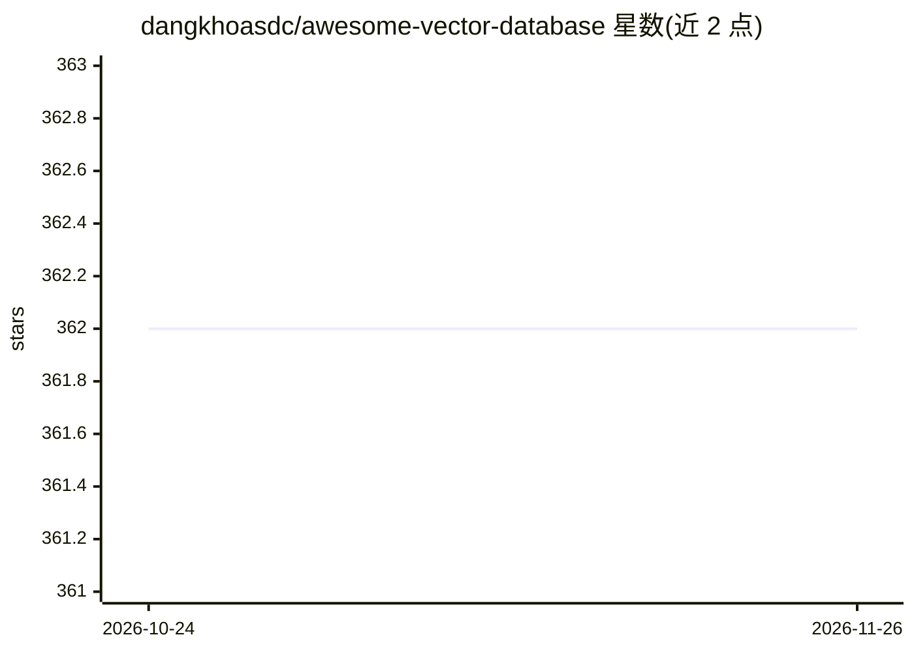

# dangkhoasdc/awesome-vector-database

⭐ 362 · CC0-1.0 · 推送 2026-11-06 · [GitHub](https://github.com/dangkhoasdc/awesome-vector-database) · 个人维护

**向量数据库与向量检索领域资源的策展清单**

围绕高维结构/向量搜索与向量数据库的收录清单，按服务、库与引擎、基准测试与数据集、书籍、会议、课程、论文（综述与量化方向）等板块组织。收录商业与开源向量数据库服务、近似最近邻搜索库、ANN 基准与向量数据库基准工具、大学课程与讲座幻灯片/视频链接，以及 2017-2026 年间的量化与索引相关论文条目。纯链接型清单，本身不含可安装的代码或运行环境。

## 筛选速览

| 维度 | 判定 | 备注 |
|---|---|---|
| AI 角色 | `ai-knowledge` | 知识聚合/清单类 |
| 许可风险 | `viral` | CC0-1.0 |
| 部署形态 | `None` |  |
| 模型依赖 | — | README 未给出锁定关系 |
| 硬件要求 | — | 无带数字的原话,不猜 |
| 安装摩擦 | `low` | 无编译、无系统依赖或容器化 |
| 成熟度 | — | 结构信号不足 |

## 能力要点

- 分类收录 20+ 向量数据库/搜索服务（含 Vertex AI、Pinecone、Weaviate 等）
- 库与引擎板块覆盖 40+ 向量检索库（Faiss、Qdrant、Milvus、pgvector 等）
- 收录 ANN/向量数据库基准工具、竞赛结果与数据集链接
- 论文板块按综述与量化方向组织，含多条附 Paper/Code 链接的条目

## 适用场景

- 为项目选型时查找可用的向量数据库服务与引擎
- 查找近似最近邻搜索的基准测试结果与数据集
- 按论文条目跟进向量量化与索引方向的研究进展
- 查找向量检索相关的课程与讲座资料

## 场景标签

`精选清单` · 领域:学习与行业

## 证据(README 行号)

> L1: # :mag: Awesome Vector Database Awesome
> L2: A curated list of awesome works related to high dimensional structure/vector search &amp; database
> L33: # Libraries & Engines

## 星数曲线

2026-10-24 362 → 2026-11-26 362（+0）

---
*卡片 v1 · prompt 1.4 · 生成 2026-11-25 · 置信度 high · 依据 README sha `a3fe3b10a610` · [字段定义](../../DATASET.md)*
