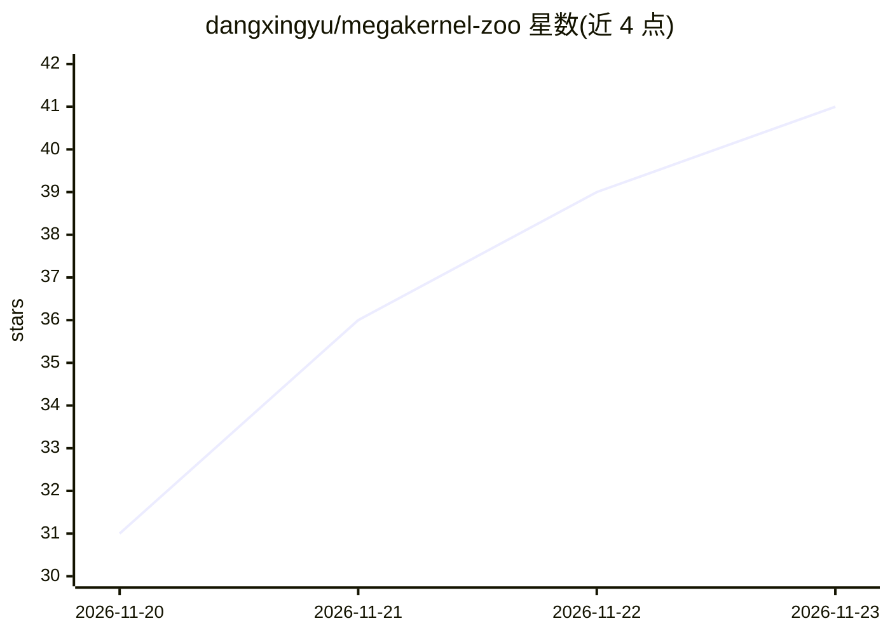

# dangxingyu/megakernel-zoo

⭐ 41 · Cuda · Apache-2.0 · 推送 2026-11-22 · [GitHub](https://github.com/dangxingyu/megakernel-zoo) · [官网](https://dangxingyu.github.io/megakernel/) · 个人维护

**为单一模型+GPU 编写的 megakernel LLM 解码引擎集合与服务器**

收录由编码 agent（Claude）在固定评估器下自主优化生成、并经审计的 LLM 推理引擎，每个引擎绑定一个 checkpoint 和一种 GPU 架构；整个 decode 步骤合为单个持久 CUDA 内核运行。仓库提供 OpenAI 兼容的 mkserve 服务器（流式与采样）、基准测试与评估套件（logits 须与 FP64 参考逐位匹配后才计时），以及 autoresearch 工具包用于在其他模型/GPU 上复现同类优化。当前含 8 个模型共 19 个引擎，仅支持 H100/B200，引擎首次使用时从源码编译。

## 筛选速览

| 维度 | 判定 | 备注 |
|---|---|---|
| AI 角色 | `ai-ecosystem` | LLM/agent 周边工具 |
| 许可风险 | `permissive` | Apache-2.0 |
| 部署形态 | `library` | 以包/库形式分发 |
| 模型依赖 | — | README 未给出锁定关系 |
| 硬件要求 | — | 无带数字的原话,不猜 |
| 安装摩擦 | `medium` | 含编译或系统依赖之一 |
| 成熟度 | — | 结构信号不足 |

## 能力要点

- 引擎由编码 agent 自主优化生成，runs/ 保存每次提交的源码、假设与得分
- mkserve 通过 OpenAI completions/chat-completions API 提供服务，支持流式与采样
- 引擎仅在 logits 与 FP64 参考逐位置匹配后计时，评估器与参考构建器随仓库提供
- 附 autoresearch 工具包，可在其他模型或 GPU 上运行同类优化

## 适用场景

- 在 H100/B200 上以单序列稳定解码或在线服务方式运行特定模型
- 通过 OpenAI 兼容客户端接入本地 megakernel 引擎
- 用 autoresearch 工具包为新模型/GPU 生成定制推理引擎
- 对比 megakernel 引擎与通用引擎的同卡基准数据

## 场景标签

`推理引擎` · 领域:训练与推理

## 证据(README 行号)

> L23: evaluator, and audited afterwards. The repository contains the engines, an OpenAI-compatible server for them, the
> L31: - `mkserve` serves any engine through the OpenAI completions and chat-completions API, with streaming and sampling.

## 星数曲线

2026-11-20 31 → 2026-11-23 41（+10）

---
*卡片 v1 · prompt 1.4 · 生成 2026-11-20 · 置信度 high · 依据 README sha `387cd69dae00` · [字段定义](../../DATASET.md)*
