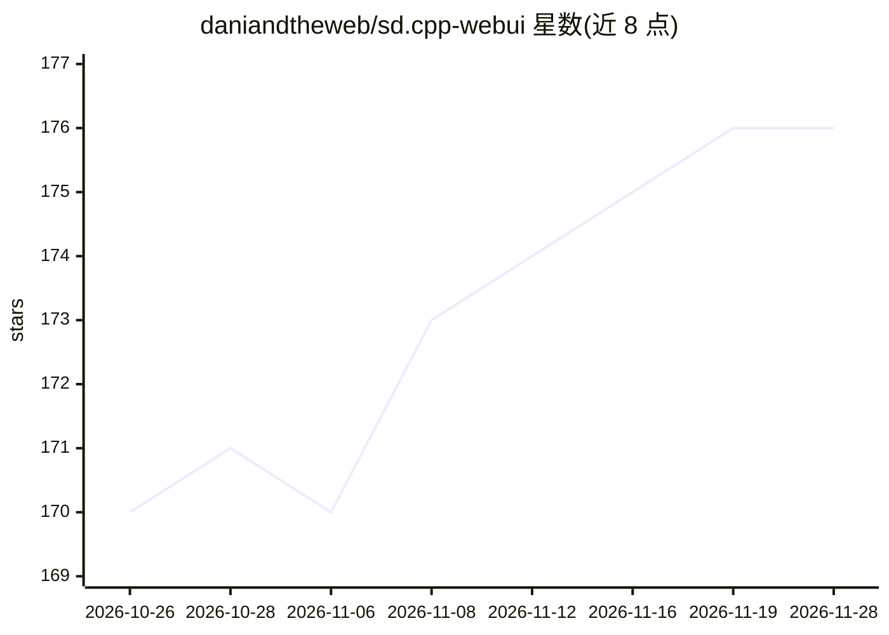

# daniandtheweb/sd.cpp-webui

⭐ 176 · Python · AGPL-3.0 · 推送 2026-11-13 · [GitHub](https://github.com/daniandtheweb/sd.cpp-webui) · 个人维护

**stable-diffusion.cpp 的轻量 Gradio 本地文生图/视频界面**

为 stable-diffusion.cpp 提供 Gradio 网页界面，核心定位是命令生成器：用户在浏览器中配置参数，由后端 stable-diffusion.cpp 二进制完成文生图与视频生成的推理，另带图库、图片元数据读取、模型管理、可选登录保护与插件机制。主要 Python 依赖仅 Gradio，不需 PyTorch；需自行编译或下载 stable-diffusion.cpp 可执行文件放入主目录，通过启动脚本在 http://localhost:7860/ 访问。面向想在本地运行图像生成模型的用户。

## 筛选速览

| 维度 | 判定 | 备注 |
|---|---|---|
| AI 角色 | `ai-native` | 本体是模型或模型工具 |
| 许可风险 | `viral` | AGPL-3.0 |
| 部署形态 | `desktop` | 安装包/桌面程序 |
| 模型依赖 | — | README 未给出锁定关系 |
| 硬件要求 | — | 无带数字的原话,不猜 |
| 安装摩擦 | `low` | 无编译、无系统依赖或容器化 |
| 成熟度 | — | 结构信号不足 |

## 能力要点

- 最小依赖（Gradio 为主，不需 PyTorch）
- 支持 stable-diffusion.cpp 的大量图像/视频生成模型（SD 系列与 FLUX 系列、Wan2.x、Qwen Image 等）
- 内置图库、生成元数据读取与模型管理标签页
- 插件系统：Civitai 下载、rembg 蒙版、OpenPose 骨架、分块放大扩展

## 适用场景

- 本地运行 SD/FLUX 等模型生成图片和视频
- 用图库和元数据读取管理生成结果
- 通过 Civitai 扩展直接搜索并下载模型
- 给照片做蒙版或 OpenPose 骨架用作 img2img/ControlNet 输入

## 场景标签

`图像生成` `视频生成` · 领域:内容生成

## 证据(README 行号)

> L3: **sd.cpp-webui** is a simple, lightweight Gradio-based web interface for stable-diffusion.cpp.
> L5: Designed to run local AI text-to-image and video generation models without heavy dependencies, this program acts pri

## 星数曲线

2026-10-26 170 → 2026-11-28 176（+6）

---
*卡片 v1 · prompt 1.4 · 生成 2026-11-26 · 置信度 high · 依据 README sha `5d4025936111` · [字段定义](../../DATASET.md)*
