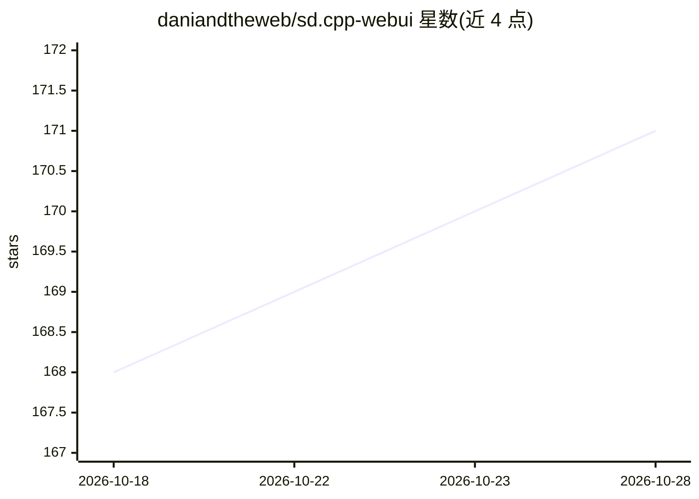

# daniandtheweb/sd.cpp-webui

⭐ 171 · Python · AGPL-3.0 · 推送 2026-10-28 · [GitHub](https://github.com/daniandtheweb/sd.cpp-webui) · 个人维护

**本地文生图/视频的轻量 Gradio WebUI，驱动 stable-diffusion.cpp**

基于 Gradio 的网页前端，本体作为 stable-diffusion.cpp 的命令生成器，用于本地运行 SD/FLUX/Qwen Image/Wan 等图像与视频生成模型。Python 依赖少（无需 PyTorch），提供实时生成预览、内置图库、图像元数据读取与可选登录保护。需另获取 stable-diffusion.cpp 的 sd-cli 二进制（自行编译或从 releases 下载）放入主目录，通过 shell/PowerShell 脚本启动，浏览器访问 localhost:7860。

## 筛选速览

| 维度 | 判定 | 备注 |
|---|---|---|
| AI 角色 | `ai-ecosystem` | LLM/agent 周边工具 |
| 许可风险 | `viral` | AGPL-3.0 |
| 部署形态 | `desktop` | 安装包/桌面程序 |
| 模型依赖 | — | README 未给出锁定关系 |
| 硬件要求 | — | 无带数字的原话,不猜 |
| 安装摩擦 | `low` | 无编译、无系统依赖或容器化 |
| 成熟度 | — | 结构信号不足 |

## 能力要点

- 作为 stable-diffusion.cpp 的命令生成器，支持其大部分功能
- 轻量依赖：仅需 Gradio，无需 PyTorch
- 实时生成预览、内置图库与元数据读取
- 支持 SD1.x–SD3.5、FLUX、Qwen Image、Wan2.x、ControlNet、LoRA 等模型

## 适用场景

- 在本地用 stable-diffusion.cpp 跑文生图/视频模型并得到网页操作界面
- 浏览生成历史并读取图像中的生成参数
- 在低依赖环境中搭建本地图像生成工作流

## 场景标签

`图像生成` `视频生成` · 领域:内容生成

## 证据(README 行号)

> L3: **sd.cpp-webui** is a simple, lightweight Gradio-based web interface for stable-diffusion.cpp.
> L5: Designed to run local AI text-to-image and video generation models without heavy dependencies, this program acts pri
> L50:  2. Obtain the `stable-diffusion.cpp` binary (sd-cli for Linux/MacOS or sd-cli.exe for Windows) by compiling or dow

## 星数曲线

2026-10-18 168 → 2026-10-28 171（+3）

---
*卡片 v1 · prompt 1.4 · 生成 2026-10-22 · 置信度 high · 依据 README sha `519732e2a36f` · [字段定义](../../DATASET.md)*
