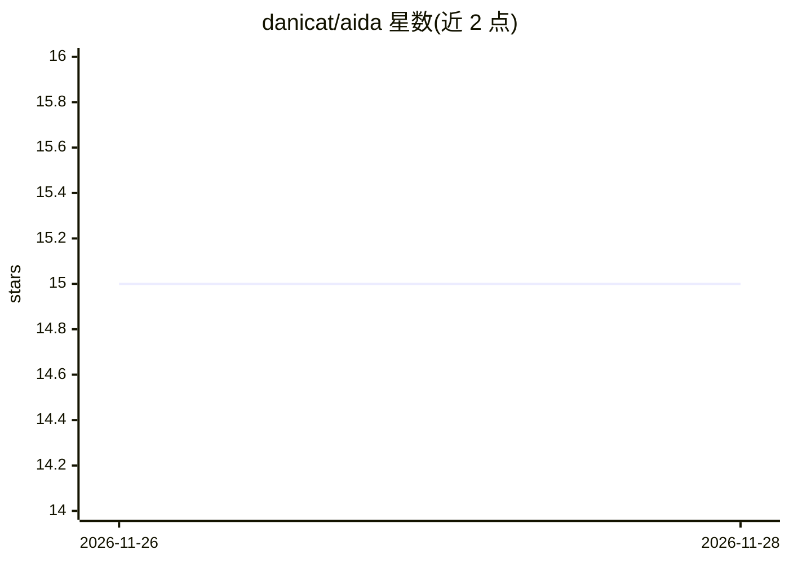

# danicat/aida

⭐ 15 · TypeScript · Apache-2.0 · 推送 2026-11-24 · [GitHub](https://github.com/danicat/aida) · [官网](https://danicat.dev) · 个人维护

**本地隐私优先的系统故障诊断 Agent：用 osquery 与 RAG 排查问题**

AIDA 是运行在本机的应急诊断 Agent，通过 osquery 检查系统状态，并使用本地 RAG（基于 sqlite-vec 的 SQLite 向量检索）理解 osquery 的 280+ 表结构 schema 与专家编写的查询包，用于恶意软件排查等诊断任务。LLM 支持本地（经 Ollama）与 Gemini 2.5 Flash 多模型切换，嵌入模型 Gemma-300M 在本机运行。前置要求 Python 3.12+、git、本地 Ollama 与 osquery，通过 setup.sh 自动化安装并构建知识库，FastAPI 后端提供浏览器界面。

## 筛选速览

| 维度 | 判定 | 备注 |
|---|---|---|
| AI 角色 | `ai-native` | 本体是模型或模型工具 |
| 许可风险 | `permissive` | Apache-2.0 |
| 部署形态 | `None` |  |
| 模型依赖 | local-ok | 支持本地模型 |
| 硬件要求 | — | 无带数字的原话,不猜 |
| 安装摩擦 | `low` | 无编译、无系统依赖或容器化 |
| 成熟度 | — | 结构信号不足 |

## 能力要点

- 100% 本地运行，经 Ollama 使用本地 LLM 与端侧嵌入模型
- 基于 sqlite-vec 的持久化 RAG，覆盖 osquery schema 与查询包
- 支持 Gemini 2.5 Flash、Qwen 2.5、GPT-OSS 多模型切换
- 内置数百条专家查询，可按操作系统过滤，支持自定义查询构造

## 适用场景

- 本机系统出现故障时做应急诊断排查
- 在隐私敏感环境下进行恶意软件排查
- 需要按 osquery schema 构造自定义系统查询

## 场景标签

`RAG` · 领域:知识与检索

## 证据(README 行号)

> L3: AIDA is a local, privacy-focused emergency diagnostic agent. It leverages `osquery` to inspect system state and uses
> L9: * **100% Local & Private**: Runs entirely on your machine using local LLMs (via Ollama) and on-device embedding mode
> L20: * **LLM**: Supports **Gemini 2.5 Flash**, **Qwen 2.5**, and **GPT-OSS** (via Ollama) for reasoning and tool use.

## 星数曲线

2026-11-26 15 → 2026-11-28 15（+0）

---
*卡片 v1 · prompt 1.4 · 生成 2026-11-26 · 置信度 high · 依据 README sha `ac7eb286c3cf` · [字段定义](../../DATASET.md)*
