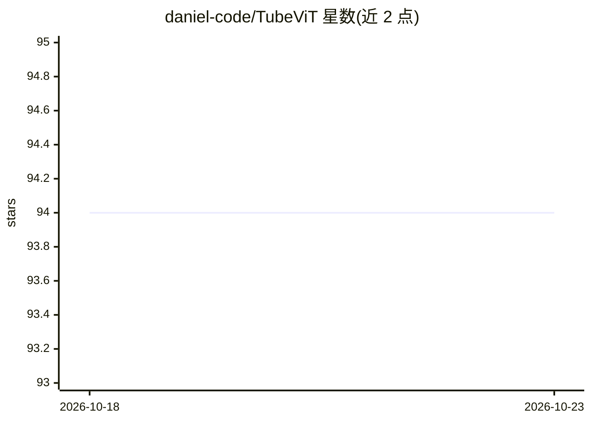

# daniel-code/TubeViT

⭐ 94 · Python · MIT · 推送 2026-07-15 · [GitHub](https://github.com/daniel-code/TubeViT) · 个人维护

**TubeViT 视频分类模型的论文非官方 PyTorch 实现**

论文 "Rethinking Video ViTs: Sparse Video Tubes for Joint Image and Video Learning" 的非官方实现，基于 torch 1.13.1 与 pytorch-lightning。已实现固定位置嵌入、Multi-Tube 与 Interpolated Kernels，训练与评估流程可运行；Sparse Tube 的 Space To Depth、tubes 配置及推理流程尚未实现。提供 ViT 预训练权重转换脚本，当前训练脚本仅支持 torchvision 的 UCF101 数据集，需自行更换数据集。

## 筛选速览

| 维度 | 判定 | 备注 |
|---|---|---|
| AI 角色 | `ai-native` | 本体是模型或模型工具 |
| 许可风险 | `permissive` | MIT |
| 部署形态 | `library` | 以包/库形式分发 |
| 模型依赖 | — | README 未给出锁定关系 |
| 硬件要求 | — | 无带数字的原话,不猜 |
| 安装摩擦 | `low` | 无编译、无系统依赖或容器化 |
| 成熟度 | — | 结构信号不足 |

## 能力要点

- 提供 ViT 预训练权重到 TubeViT 的转换脚本
- 已实现训练与评估流程（pytorch-lightning）
- Multi-Tube 与 Interpolated Kernels 已实现，Space To Depth 与推理未实现

## 适用场景

- 复现论文中的视频分类训练与评估
- 研究稀疏视频管（sparse tube）结构在 ViT 中的应用
- 在 UCF101 或自定义数据集上训练视频分类模型

## 场景标签

`微调` · 领域:训练与推理

## 证据(README 行号)

> L3: An unofficial implementation of TubeViT
> L21: This project is based on `torch==1.13.1` and pytorch-lightning

## 星数曲线

2026-10-18 94 → 2026-10-23 94（+0）

---
*卡片 v1 · prompt 1.4 · 生成 2026-10-23 · 置信度 mid · 依据 README sha `48d12ca67c14` · [字段定义](../../DATASET.md)*
