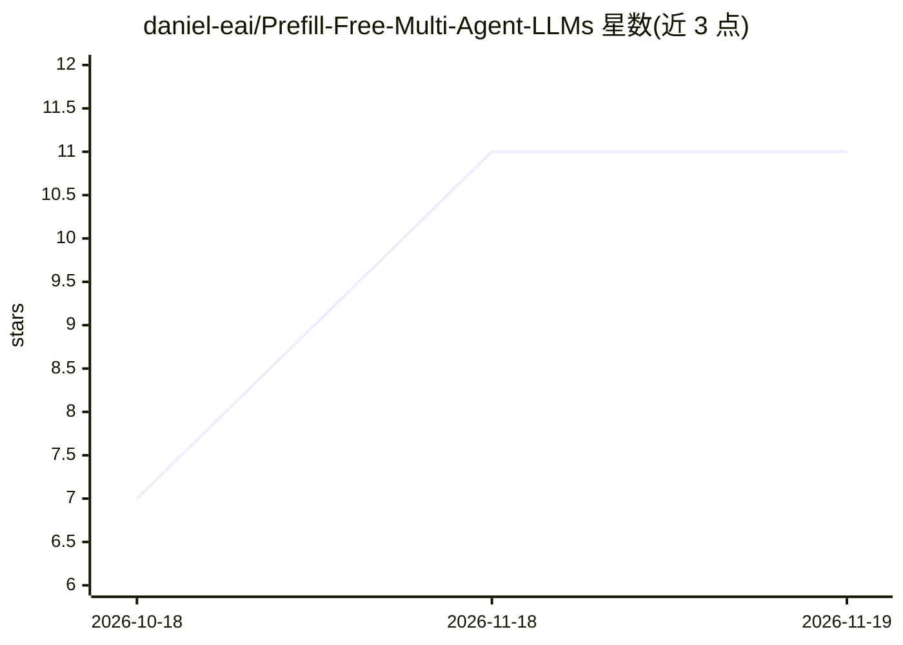

# daniel-eai/Prefill-Free-Multi-Agent-LLMs

⭐ 11 · Python · 推送 2026-10-13 · [GitHub](https://github.com/daniel-eai/Prefill-Free-Multi-Agent-LLMs) · 组织维护

**论文官方实现：跨模型家族 KV cache 迁移以省去接收端 prefill**

论文 HeteroFold 的官方代码库，面向多智能体 LLM 系统中不同模型家族之间的 KV cache 转移。机制包括 token 对齐、层对齐、基于 Procrustes 的仿射映射（Recolor）、rank-16 输出感知校准及折叠合并，使接收模型无需重新 prefill 共享上下文即可解码。仓库提供校准与评测脚本，覆盖三个模型六个方向与九个基准，结果可与论文表 1 对照。模型以 BF16 冻结加载，需 CUDA GPU，Llama 与 Ministral 为 gated 模型需 HF token。

## 筛选速览

| 维度 | 判定 | 备注 |
|---|---|---|
| AI 角色 | `ai-ecosystem` | LLM/agent 周边工具 |
| 许可风险 | `none` | — |
| 部署形态 | `library` | 以包/库形式分发 |
| 模型依赖 | — | README 未给出锁定关系 |
| 硬件要求 | — | 无带数字的原话,不猜 |
| 安装摩擦 | `medium` | 含编译或系统依赖之一 |
| 成熟度 | — | 结构信号不足 |

## 能力要点

- 五步机制：Token Alignment、Layer Alignment、Recolor 仿射映射、输出感知校准、折叠合并
- 支持三个模型（Llama-3.1-8B / Qwen3-4B / Ministral-3-14B）间六个转移方向
- 九个基准评测（LongBench/QuALITY/ARC/MMLU/GSM8K 等），支持多 GPU 分片与断点续跑
- 校准无需标签数据，使用 2000 条无标签提示

## 适用场景

- 复现论文表 1 的跨家族 KV cache 迁移实验
- 在自己的多智能体 LLM 工作流中复用 sender 的 KV cache
- 校准并生成可用于自有推理代码的 HeteroFold 映射文件

## 场景标签

`多智能体` · 领域:Agent 开发

## 证据(README 行号)

> L3: Official implementation of **Prefill-Free Cross-Family KV Cache Transfer for Heterogeneous Multi-Agent LLMs** (Heter
> L22: **HeteroFold** transfers the sender's KV cache to a receiver from another model family
> L37: This repository contains the code for the main results of the paper (Table 1): it

## 星数曲线

2026-10-18 7 → 2026-11-19 11（+4）

---
*卡片 v1 · prompt 1.4 · 生成 2026-11-18 · 置信度 high · 依据 README sha `d6510588fad9` · [字段定义](../../DATASET.md)*
