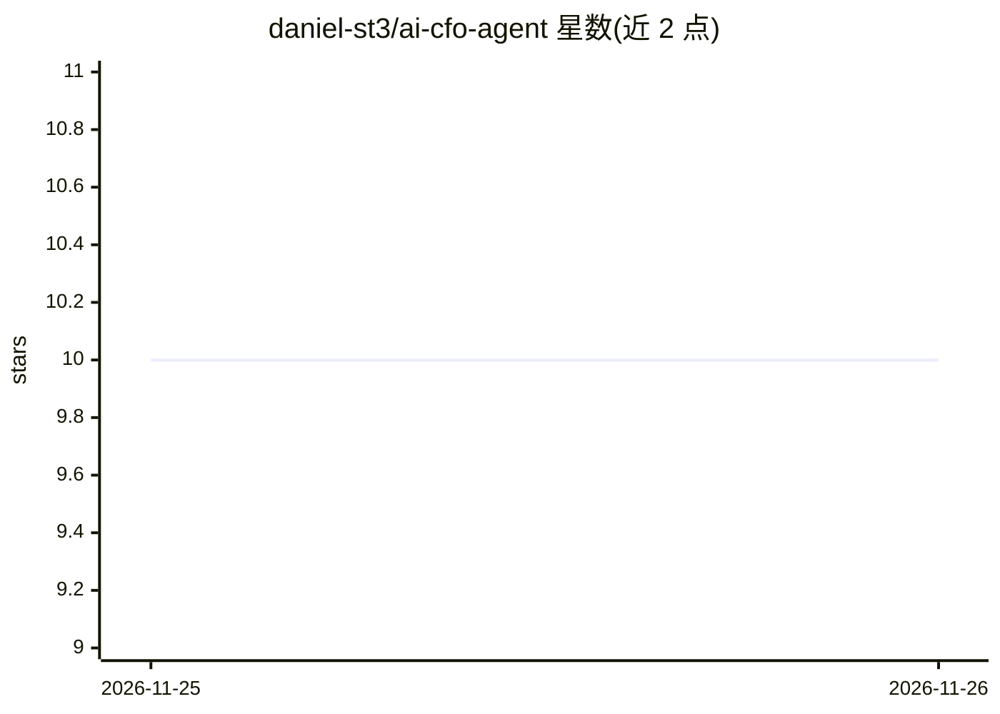

# daniel-st3/ai-cfo-agent

⭐ 10 · TypeScript · 推送 2026-03-08 · [GitHub](https://github.com/daniel-st3/ai-cfo-agent) · [官网](https://github.com/daniel-st3/ai-cfo-agent) · 个人维护

**面向初创团队的 AI CFO：上传 CSV 生成财务看板与决策建议**

自托管的财务智能平台：上传周度交易 CSV，约 30 秒内生成财务健康评分、7 项 KPI、Monte Carlo 存活分析、跑道分析、欺诈/异常检测、AI 报告与决策引擎。后端 FastAPI + LangGraph，前端 Next.js，AI 层调用 Claude Haiku（需 ANTHROPIC_API_KEY），决策层规则优先以减少 API 花费；WebSocket 流式推送进度，失败时自动回退轮询。默认 SQLite，可选 PostgreSQL/Redis/Slack/Stripe/QuickBooks 集成。

## 筛选速览

| 维度 | 判定 | 备注 |
|---|---|---|
| AI 角色 | `ai-native` | 本体是模型或模型工具 |
| 许可风险 | `permissive` | — |
| 部署形态 | `None` |  |
| 模型依赖 | locked-api |  |
| 硬件要求 | — | 无带数字的原话,不猜 |
| 安装摩擦 | `low` | 无编译、无系统依赖或容器化 |
| 成熟度 | — | 结构信号不足 |

## 能力要点

- 24 项功能：KPI、跑道、Monte Carlo 存活、欺诈/异常检测、AI 报告等
- AI CFO Decision Engine 规则优先排序行动，模拟影响并导出董事会快照
- WebSocket 流式管道，5 秒内失败自动切换轮询，UI 一致
- 每次运行 AI 推理成本约 $0.003-0.025（Claude Haiku）

## 适用场景

- 为没有 CFO 的初创团队生成董事会级财务报告
- 上传交易 CSV 检测欺诈模式与异常支出
- 做融资就绪度评估与股权稀释模拟
- 每日晨报监控跑道与紧急告警

## 场景标签

`数据分析` · 领域:效率与自动化

## 证据(README 行号)

> L8: Drop a CSV of weekly transactions and get a board-ready finance cockpit in about 30 seconds: a live **Financial Heal
> L117: |`ANTHROPIC_API_KEY`|**Yes**|Claude Haiku for all AI reports + agent reasoning|~$0.001-0.008/run|
> L254: graph/           LangGraph orchestration

## 星数曲线

2026-11-25 10 → 2026-11-26 10（+0）

---
*卡片 v1 · prompt 1.4 · 生成 2026-11-24 · 置信度 high · 依据 README sha `fb2915519af3` · [字段定义](../../DATASET.md)*
