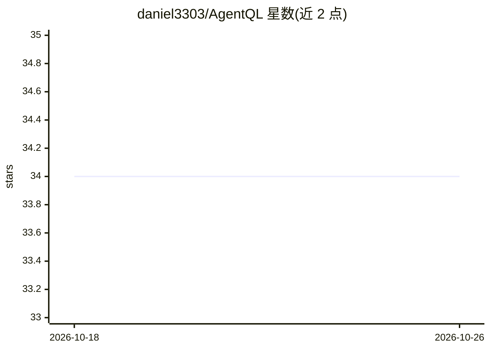

# daniel3303/AgentQL

⭐ 34 · C# · MIT · 推送 2026-08-21 · [GitHub](https://github.com/daniel3303/AgentQL) · [官网](https://danielapoliveira.com) · 个人维护

**.NET 库：将 EF Core 模型转为 LLM 可读 schema 并安全执行 SQL**

面向 .NET 开发者的可复用库，位于 EF Core 数据库与 AI 提供商之间：内省 EF Core 模型（表、列、关系、枚举、继承）生成 LLM 可推理的文本描述；在事务内执行 SQL，带行数/列数/字节/超时限制与 ReadOnly 三层防护（语句白名单、DBMS 会话只读、结束回滚）。通过 Microsoft.Extensions.AI 暴露三个工具函数（GetDatabaseSchema/ExecuteQuery/ReportFailure），支持 OpenAI、Anthropic、Ollama，内置自纠错循环。以 NuGet 包分发，Docker 仅用于构建演示应用。注意：Include/Exclude 是 schema 隐藏而非访问控制。

## 筛选速览

| 维度 | 判定 | 备注 |
|---|---|---|
| AI 角色 | `ai-ecosystem` | LLM/agent 周边工具 |
| 许可风险 | `permissive` | MIT |
| 部署形态 | `self-host` | docker 或自建部署 |
| 模型依赖 | local-ok | 支持本地模型 |
| 硬件要求 | — | 无带数字的原话,不猜 |
| 安装摩擦 | `low` | 无编译、无系统依赖或容器化 |
| 成熟度 | — | 结构信号不足 |

## 能力要点

- EF Core 模型内省生成 LLM 可读 schema 描述
- SQL 执行带行/列/字节/长度限制与 ReadOnly 三层防护
- 经 Microsoft.Extensions.AI 暴露 3 个工具函数，兼容任意 chat client
- 自纠错循环：失败后注入 system-reminder 重试至 MaxAttempts

## 适用场景

- 让 LLM agent 通过函数调用理解并查询我的 EF Core 数据库
- 在只读防护下让 AI 安全执行 SQL 查询
- 为聊天应用提供带自纠错的数据库问答工具链

## 场景标签

`数据分析` · 领域:效率与自动化

## 证据(README 行号)

> L10: Reusable .NET library that translates EF Core `DbContext` models into LLM-friendly schema descriptions and provides
> L16: AgentQL sits between your EF Core database and any AI provider (OpenAI, Anthropic, Ollama). It:

## 星数曲线

2026-10-18 34 → 2026-10-26 34（+0）

---
*卡片 v1 · prompt 1.4 · 生成 2026-10-25 · 置信度 mid · 依据 README sha `1fa93348f4b4` · [字段定义](../../DATASET.md)*
