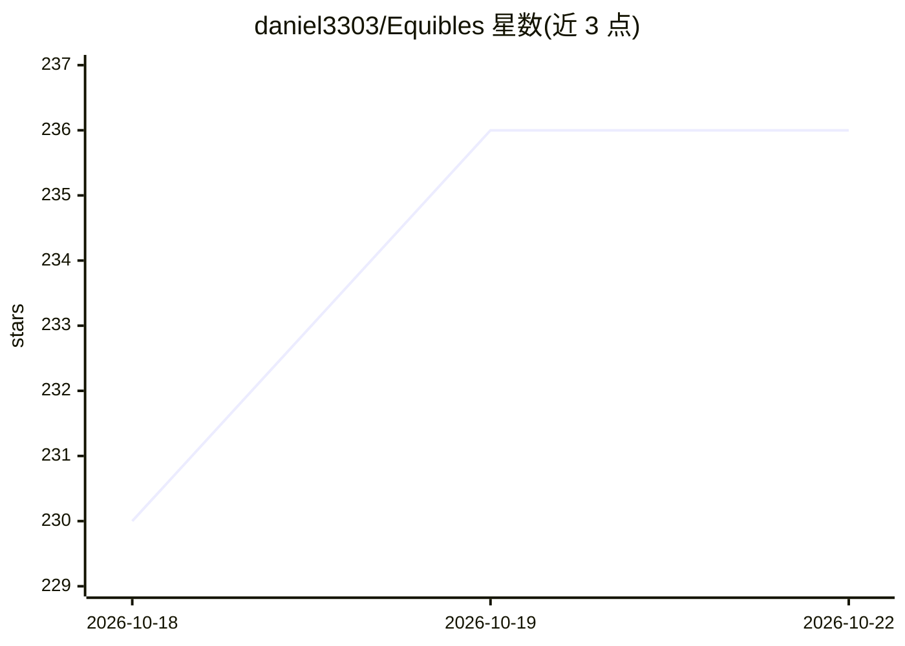

# daniel3303/Equibles

⭐ 237 · C# · AGPL-3.0 · 推送 2026-10-22 · [GitHub](https://github.com/daniel3303/Equibles) · [官网](https://equibles.com) · 个人维护

**自托管金融数据 MCP 服务器：让 AI agent 直接查询 SEC/FRED 等数据**

面向 AI agent（而非人类）的自托管金融数据服务器：抓取并存储 SEC 文件与 XBRL 财务、13F 持仓、内部人与国会议员交易、FINRA/SEC 空头数据、FRED 经济指标、CFTC/CBOE 持仓、政府合同与每日股价，以 64+ 个 MCP 工具暴露，供 Claude、ChatGPT、Cursor 等 agent 直接查询，覆盖美国及主要欧洲交易所股票。通过 Docker Compose 部署，含 ParadeDB、Web 门户、MCP 服务与抓取 worker；FINRA 与 FRED 需免费 API key（缺失时对应抓取器跳过）。可选开启向量嵌入，支持 Ollama 或 OpenAI 兼容端点。Equibles Cloud 为托管付费层，额外提供财报电话会转录、实时报价等工具。

## 筛选速览

| 维度 | 判定 | 备注 |
|---|---|---|
| AI 角色 | `ai-ecosystem` | LLM/agent 周边工具 |
| 许可风险 | `viral` | AGPL-3.0 |
| 部署形态 | `self-host` | docker 或自建部署 |
| 模型依赖 | local-ok | 支持本地模型 |
| 硬件要求 | — | 无带数字的原话,不猜 |
| 安装摩擦 | `low` | 无编译、无系统依赖或容器化 |
| 成熟度 | — | 结构信号不足 |

## 能力要点

- 64+ 个 MCP 工具覆盖 SEC 文件、13F、内幕交易、国会议员交易、FRED 等 14 类数据域
- Docker Compose 一键部署：ParadeDB 数据库 + Web 门户 + MCP 服务 + 抓取 worker
- 覆盖美国上市及欧洲主要交易所（Euronext、Xetra、LSE 等）股票，支持 MIC:TICKER 格式
- 可选向量嵌入，支持 Ollama 与 OpenAI 兼容端点（vLLM/TEI）

## 适用场景

- 让 Claude/Cursor 等 AI 助手直接查询美股与欧股的财报和持仓数据
- 自建免费金融数据栈，替代付费终端的数据获取
- 对内部人交易、国会议员交易、空头数据做自动化分析

## 场景标签

`金融量化` · 领域:学习与行业

## 证据(README 行号)

> L12: **Equibles is a self-hosted, open-source financial data MCP server** — an open-source alternative to a Bloomberg Te
> L22: Everything marked **Self-hosted** is scraped, stored, and served by this repo — **70 MCP tools**, no account, no ke

## 星数曲线

2026-10-18 230 → 2026-10-22 236（+6）

---
*卡片 v1 · prompt 1.4 · 生成 2026-10-22 · 置信度 high · 依据 README sha `694cfd7fbd2a` · [字段定义](../../DATASET.md)*
