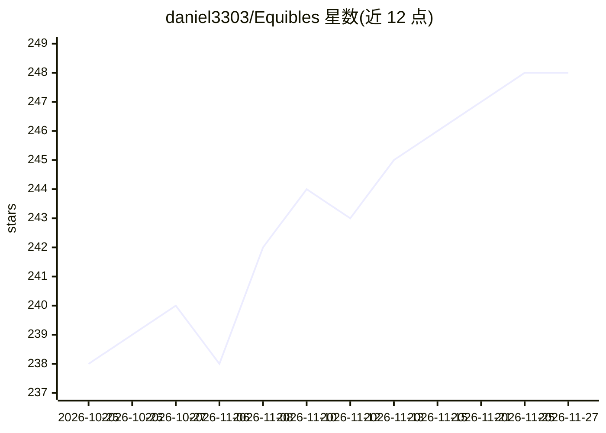

# daniel3303/Equibles

⭐ 248 · C# · AGPL-3.0 · 推送 2026-11-26 · [GitHub](https://github.com/daniel3303/Equibles) · [官网](https://equibles.com) · 个人维护

**自托管金融数据 MCP 服务器，供 AI agent 查询 SEC/市场数据**

通过 Model Context Protocol 向 AI agent 提供金融数据：抓取并存储 SEC 文件与 XBRL 财务报表、13F 持仓、内部人与国会议员交易、做空数据、FRED 经济指标、CFTC/CBOE 持仓、欧洲上市证券及日线行情，共 72 个自托管 MCP 工具，配套 Web 门户与后台抓取 worker，以 Docker Compose 部署。官方托管的 Equibles Cloud 在同一协议上追加电话会转录、实时报价、期权链、LLM 抽取 KPI 等工具，免费档每天 100 次请求。

## 筛选速览

| 维度 | 判定 | 备注 |
|---|---|---|
| AI 角色 | `ai-ecosystem` | LLM/agent 周边工具 |
| 许可风险 | `viral` | AGPL-3.0 |
| 部署形态 | `self-host` | docker 或自建部署 |
| 模型依赖 | local-ok | 支持本地模型 |
| 硬件要求 | — | 无带数字的原话,不猜 |
| 安装摩擦 | `low` | 无编译、无系统依赖或容器化 |
| 成熟度 | — | 结构信号不足 |

## 能力要点

- 72 个自托管 MCP 工具，覆盖 SEC 文件、13F、内部人/国会交易、做空、FRED 等数据源
- Docker Compose 一键启动 db/web/mcp/worker 四个服务
- 支持美国上市及欧洲主要交易所（Euronext、Xetra、伦敦等）证券，按 ISIN 与 MIC:TICKER 检索
- 可选启用向量嵌入生成；FINRA/FRED 需免费 API key，缺省时跳过不影响其他抓取器

## 适用场景

- 让 Claude/Cursor 等 agent 直接查询 SEC 文件与持仓数据
- 自托管一套本地金融数据管道并长期回填历史数据
- 用 MCP 工具对财报、内部人交易做定量研究

## 场景标签

`金融量化` · 领域:学习与行业

## 证据(README 行号)

> L12: **Equibles is a self-hosted, open-source financial data MCP server** — an open-source alternative to a Bloomberg Te
> L22: Everything marked **Self-hosted** is scraped, stored, and served by this repo — **72 MCP tools**, no account, no ke
> L96: |**mcp**|8081|MCP server for AI assistants|

## 星数曲线

2026-10-25 238 → 2026-11-27 248（+10）

---
*卡片 v1 · prompt 1.4 · 生成 2026-11-25 · 置信度 high · 依据 README sha `c868cff1d777` · [字段定义](../../DATASET.md)*
