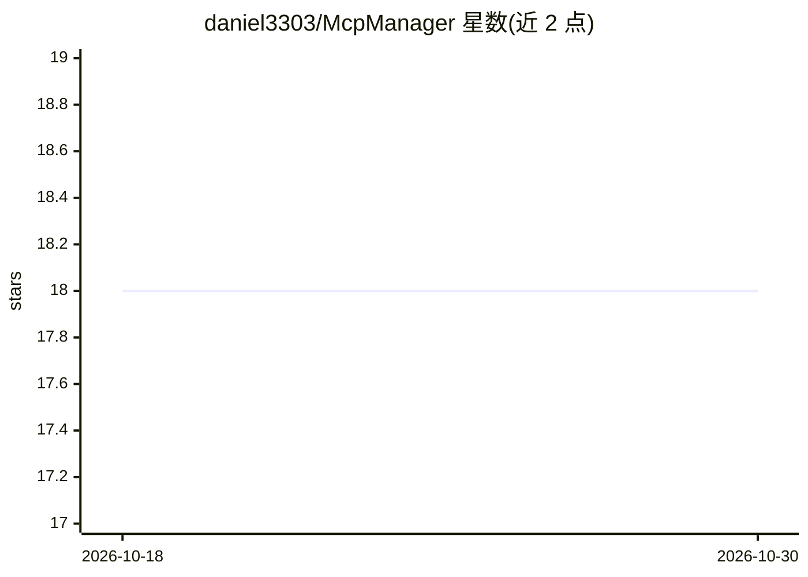

# daniel3303/McpManager

⭐ 18 · C# · MIT · 推送 2026-08-13 · [GitHub](https://github.com/daniel3303/McpManager) · 个人维护

**自托管的 MCP 代理与聚合平台，多服务器统一单一端点**

部署在 AI 客户端（Claude Code、Cursor、Windsurf 等）与多个 MCP 服务器之间的代理聚合层：注册一次上游服务器，客户端连接单一 /mcp 端点即可访问全部工具。支持 HTTP/SSE、Stdio、OpenAPI 自动转 MCP 工具三种传输，提供命名空间路由、每命名空间限流与工具级定制、健康检查通知、Playground 在线执行工具、作用域 API key（mcpm_ 前缀）与多用户权限管理、请求日志实时流。可从 Claude Desktop/Cursor/Opencode 配置导入。后端 .NET 10 + SQLite，以 Docker 镜像或源码方式运行。

## 筛选速览

| 维度 | 判定 | 备注 |
|---|---|---|
| AI 角色 | `ai-ecosystem` | LLM/agent 周边工具 |
| 许可风险 | `permissive` | MIT |
| 部署形态 | `self-host` | docker 或自建部署 |
| 模型依赖 | — | README 未给出锁定关系 |
| 硬件要求 | — | 无带数字的原话,不猜 |
| 安装摩擦 | `low` | 无编译、无系统依赖或容器化 |
| 成熟度 | — | 结构信号不足 |

## 能力要点

- 多上游 MCP 服务器工具聚合到单一 /mcp 端点
- HTTP/SSE、Stdio、OpenAPI-to-MCP 三种传输及各自认证方式
- 命名空间隔离：独立限流、API key 作用域、逐工具启停与参数覆盖
- Playground 浏览器内按 JSON schema 动态构建表单执行工具
- 从 Claude Desktop / Cursor / Opencode 配置文件导入服务器

## 适用场景

- 多个 MCP 客户端共享一套服务器配置，避免逐客户端重复配置
- 把 REST API（OpenAPI 规范）转为 MCP 工具供 AI 调用
- 团队多用户管理 MCP 服务器访问权限与审计调用日志
- 按命名空间对不同项目做限流与工具集裁剪

## 场景标签

`模型网关` · 领域:Agent 开发

## 证据(README 行号)

> L3: **A self-hosted MCP proxy and aggregation platform.**
> L36: MCP Manager sits between your AI tools (Claude Code, Cursor, Windsurf, etc.) and your MCP servers. Instead of confi
> L42: ### Unified MCP Proxy

## 星数曲线

2026-10-18 18 → 2026-10-30 18（+0）

---
*卡片 v1 · prompt 1.4 · 生成 2026-10-29 · 置信度 high · 依据 README sha `ffd61235f7b8` · [字段定义](../../DATASET.md)*
