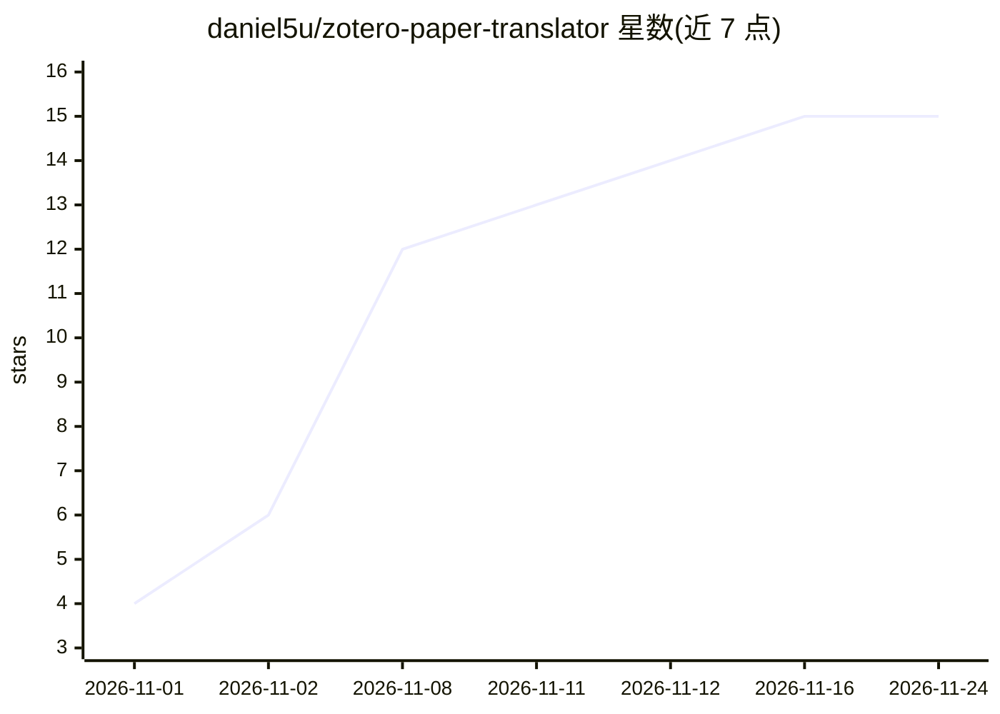

# daniel5u/zotero-paper-translator

⭐ 15 · JavaScript · AGPL-3.0 · 推送 2026-11-21 · [GitHub](https://github.com/daniel5u/zotero-paper-translator) · 个人维护 · 中文 README

**Zotero 插件：用自有 OpenAI 兼容 API 整页翻译 PDF 论文并保留版式**

面向 Zotero 7–10 用户的文献翻译插件，基于 BabelDOC 引擎把整页或整篇 PDF 论文翻译为保留原版式、公式与图表的译文。用户配置自己的 OpenAI 兼容 API 地址、Key 与模型；插件用 uv 自动创建 Python 3.12 环境并安装 BabelDOC（首次约下载 1 GB）。支持段落右键即时翻译、按页码/章节批量翻译、翻译队列与进度/token 统计，段落请求附带标题与上下文；'测试连接' 会自动检测关闭思考与输出上限字段的写法。译文长期保存，解析缓存 7 天自动清理。

## 筛选速览

| 维度 | 判定 | 备注 |
|---|---|---|
| AI 角色 | `ai-native` | 本体是模型或模型工具 |
| 许可风险 | `viral` | AGPL-3.0 |
| 部署形态 | `None` |  |
| 模型依赖 | — | README 未给出锁定关系 |
| 硬件要求 | — | 无带数字的原话,不猜 |
| 安装摩擦 | `low` | 无编译、无系统依赖或容器化 |
| 成熟度 | — | 结构信号不足 |

## 能力要点

- 整页/整篇 PDF 翻译，保留版式、公式与图表
- 任意 OpenAI 兼容 API，自动检测思考关闭与输出上限字段写法
- 批量翻译队列，显示进度、token 用量，可暂停/跳过/重试并断点续传
- uv 自动管理 Python 3.12 环境与 BabelDOC 安装（首次约 1 GB）

## 适用场景

- 阅读外文文献时在 Zotero 内直接获得保留版式的全文翻译
- 对文献库中的多篇论文批量排队翻译并跟踪进度
- 悬停段落逐段翻译，控制成本与范围

## 场景标签

`科研工具` · 领域:学习与行业

## 证据(README 行号)

> L3: 一个在原生 PDF 阅读器中选择页面或段落进行文本翻译的 Zotero 插件。
> L5: 这个插件能保留原有版式、公式和图表，只要你有自己的 OpenAI 兼容 API。目前支持 Zotero 7 – 10（在 Zotero 7.0.32 / macOS、Zotero 10.0.7 / macOS 和 Zotero 10

## 星数曲线

2026-11-01 4 → 2026-11-24 15（+11）

---
*卡片 v1 · prompt 1.4 · 生成 2026-11-18 · 置信度 high · 依据 README sha `d71dadd3189d` · [字段定义](../../DATASET.md)*
