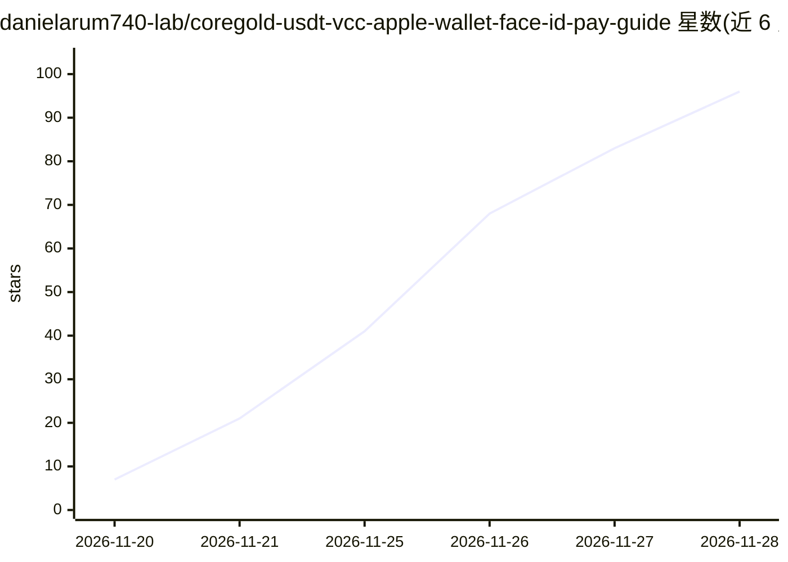

# danielarum740-lab/coregold-usdt-vcc-apple-wallet-face-id-pay-guide

⭐ 96 · 推送 2026-11-19 · [GitHub](https://github.com/danielarum740-lab/coregold-usdt-vcc-apple-wallet-face-id-pay-guide) · [官网](https://app.coregold.io/signup?invite_code=ADvlj9b) · 个人维护 · 中文 README

**将 CoreGold USDT 虚拟卡添加至美区 Apple Wallet 的教程**

一份分步教程，演示如何将 CoreGold 虚拟卡（VCC）手动录入 US 区 Apple Wallet 完成令牌化，并通过 CoreGold 面板实时获取验证码（OTP）完成卡片验证；绑定后可使用 Face ID 在设备上完成付款。面向需要跨境支付 SaaS 与 AI 工具订阅费用的用户。文档以纯文本步骤形式提供，无代码、无安装内容。

## 筛选速览

| 维度 | 判定 | 备注 |
|---|---|---|
| AI 角色 | `ai-knowledge` | 知识聚合/清单类 |
| 许可风险 | `none` | — |
| 部署形态 | `None` |  |
| 模型依赖 | — | README 未给出锁定关系 |
| 硬件要求 | — | 无带数字的原话,不猜 |
| 安装摩擦 | `low` | 无编译、无系统依赖或容器化 |
| 成熟度 | — | 结构信号不足 |

## 能力要点

- 分步教程：手动录入卡号将 CoreGold VCC 添加到 Apple Wallet
- 在 CoreGold 面板实时获取卡片验证码（OTP）
- 绑定后通过 Face ID 一键付款

## 适用场景

- 为跨境 SaaS 订阅绑定 USDT 虚拟卡到 Apple Pay
- 支付 Claude Pro、Notion、App Store 等订阅费用时使用 Face ID 结账

## 场景标签

`教程课程` · 领域:学习与行业

## 证据(README 行号)

> L2: Masterclass on tokenizing CoreGold USDT virtual cards into US Apple Wallet, enabling hardware-encrypted Face ID chec
> L9: This tutorial demonstrates how to mount a CoreGold VCC into your US Apple Wallet and retrieve real-time OTP verifica

## 星数曲线

2026-11-20 7 → 2026-11-28 96（+89）

---
*卡片 v1 · prompt 1.4 · 生成 2026-11-20 · 置信度 high · 依据 README sha `e0ee2339a57c` · [字段定义](../../DATASET.md)*
